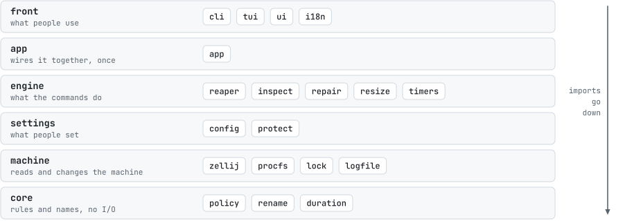
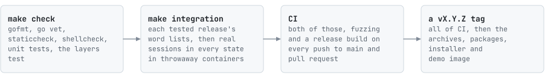

# Contributing to zellij-reaper

zellij-reaper deletes sessions without asking, so a change has to come with a test showing it still keeps every session
it should. Almost all of it can be worked on without touching your own sessions: the unit tests build fake machines, the
integration tests run real zellij in throwaway containers, and `make demo` opens the dashboard in one.

- [Ways to help](#ways-to-help)
- [How the pieces fit](#how-the-pieces-fit)
- [Build and try it](#build-and-try-it)
- [Run the tests](#run-the-tests)
- [Make a change](#make-a-change): a rule, a setting, a protected program, a zellij release, a language, the dashboard
- [Style](#style)
- [Report a problem](#report-a-problem)

## Ways to help

- **Run it on another setup.** A zellij release, a distribution or a shell CI does not cover: say what `doctor` and `plan`
  report there.
- **A session it got wrong.** A session it kept for no good reason, or one it should have kept, is the most useful report
  there is.
- **A program it should know.** A coding agent or another program people leave running on purpose
  ([protected programs](#a-protected-program)), or a default title that says nothing ([names](#a-kind-of-title)).
- **Translations.** English and Korean today ([a language](#a-language)).
- **Docs.** Anything that made you stop and search is worth a sentence.

## How the pieces fit

The code sits in layers, and an import goes down the layers, never up. `internal/layers_test.go` fails otherwise.

<picture>
  <source media="(prefers-color-scheme: dark)" srcset="../docs/assets/layers-dark.svg">
  
</picture>

One pass runs through them from the bottom up: `inspect` gathers the facts from `procfs` and `zellij`, `policy` decides
from the facts alone, `reaper` acts on the verdicts and writes to `logfile`, and `tui` and `cli` put the same verdicts into
their own words. [Internals](../docs/internals.md) has the reasons behind each part.

## Build and try it

You need Go (the version in `go.mod`; `go` fetches it if yours is older) and, for the integration tests and the sandbox,
Docker.

```sh
git clone https://github.com/kanggu12/zellij-reaper && cd zellij-reaper
make build && dist/zellij-reaper plan
```

`plan` and the dashboard change nothing until you press a key that acts, so they are safe on your own sessions. `run` is
not: use `run --dry-run`, or `make demo`, which stages the same demo sessions in the integration image and mounts the
binary you just built. The published demo image is built from `test/demo/Dockerfile`.

## Run the tests

```sh
make check                               # gofmt, go vet, staticcheck, shellcheck, go test -race ./...
make integration                         # real zellij, every release in the matrix, in containers
make integration ZELLIJ_VERSIONS=0.45.1  # one release
```

<picture>
  <source media="(prefers-color-scheme: dark)" srcset="../docs/assets/release-dark.svg">
  
</picture>

Unit tests build fake machines with `internal/testutil`: a `/proc` with chosen processes and terminals, real Unix sockets
for the inode matching, session files with chosen times. [Internals](../docs/internals.md#tests) lists what each level
covers. A failing integration check prints the plan and the last pass in the log.

## Make a change

### A rule

It goes in `internal/core/policy`: a `Code`, its place in `Decide`, its `LogText`, its words in both catalogs (`why.*`,
`check.*`), and rows in `policy_test.go`. A fact that cannot be read must keep the session.

### A setting

Add it in `internal/settings/config/config.go`: the field, `Keys`, `Default`, `fileShape`, `loadFile`, `EnvNames` and
`loadEnv` when it takes a variable, and `Value`. Then its note in `template.go`, its row in `docs/setup.md`, and a test
that a value it cannot read stops the command.

### A protected program

It goes in `config.DefaultProtectCommands`, and in the defaults in `docs/setup.md`. If it runs as an interpreter's script,
check that `TestProtectedCommands` finds it.

### A kind of title

`internal/core/rename` turns titles into names, and every kind of title is a row in `rename_test.go`. A program's default
title that says nothing about the session goes in `agentTitles`. Try a change on real titles from your own log with
`grep -o 'panes={[^}]*}' ~/.local/state/zellij-reaper/reaper.log | sort -u`.

### A zellij release

Run `make integration ZELLIJ_VERSIONS=x.y.z`. If it passes, add it to the matrix in `.github/workflows/ci.yml` and to
`default_versions` in `test/integration/run.sh`. If it fails, record what changed (`list-sessions -n`, `action
list-clients`, a `session-metadata.kdl`) under `internal/machine/zellij/testdata/x.y.z/`, add a parser test, then fix.

### A dependency

After adding, removing or upgrading a module, run `make notices`. CI fails while `docs/THIRD_PARTY_NOTICES.md` does not
match what the binary is built from.

### A language

Add a catalog next to `en` and `ko` in `internal/front/i18n/catalog.go`, then a `Lang` constant, its entry in `catalogs`,
and its locale prefix in `Detect` and `Set` (`i18n.go`). `go test ./internal/front/...` checks that every key and
placeholder is there and that every frame still fits.

### The dashboard

`go test ./internal/front/tui/` renders every state at five sizes in both languages. `zellij-reaper tui --snapshot 132x32`
prints one frame (a hidden flag; also `--theme light`, `--select NAME`); the screenshots in `docs/assets` come from such
frames, taken in the `make demo` sandbox.

## Style

- The log's words are an interface: add new kinds of lines, never reword the ones there.
- Words people see go through `i18n.T`, in English and Korean. In Korean, a particle never follows a name directly (the
  catalog tests check).
- Comment nearly every step, saying why it is there.
- Commits: a short subject in the imperative ("Keep sessions with a web client attached"), then what was wrong, what
  changed and how it was checked.

By contributing you agree that your contribution is licensed under the [MIT License](../LICENSE), and to follow the
[code of conduct](CODE_OF_CONDUCT.md).

## Report a problem

- **A session it got wrong**, kept or deleted: open an issue with `zellij-reaper doctor`, `zellij-reaper plan --json` for
  that session, its lines from `zellij-reaper logs`, `zellij --version`, and what was running in it.
- **A larger change** (a new rule, a new setting): open an issue first, so the behavior is agreed before the code.
- **A security problem**: see [SECURITY.md](SECURITY.md), not an issue.
