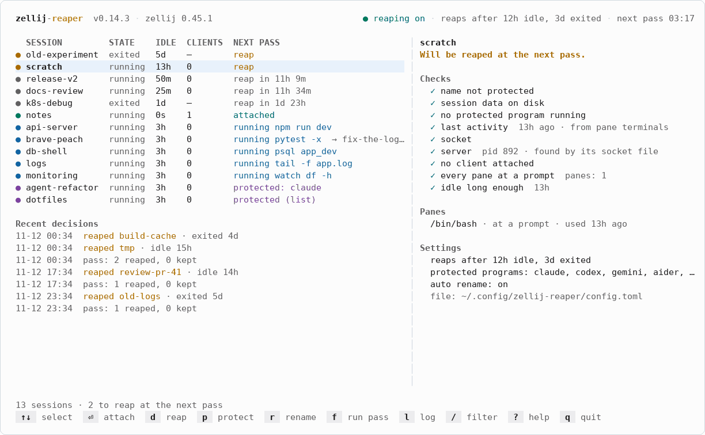
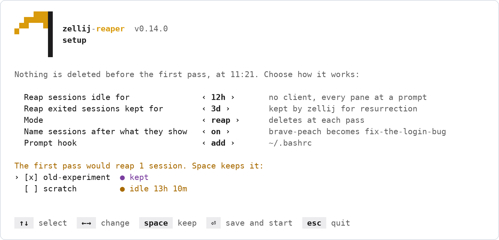
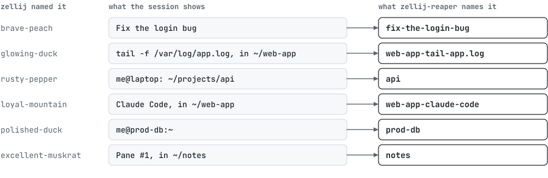
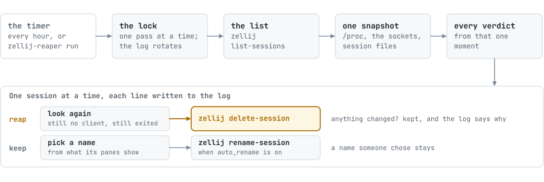

<p align="center">
  <picture>
    <source media="(prefers-color-scheme: dark)" srcset="docs/assets/logo-dark.svg">
    
  </picture>
</p>

<p align="center">
  <b>Deletes the zellij sessions you stopped using. Keeps the ones you use.</b><br>
  Once an hour it looks at every session: who is attached, what runs in its panes, when it was last used.
</p>

<p align="center">
  <a href="https://github.com/kanggu12/zellij-reaper/actions/workflows/ci.yml"></a>
  <a href="https://github.com/kanggu12/zellij-reaper/releases"></a>
  <a href="LICENSE"></a>
  <a href="https://github.com/kanggu12/zellij-reaper/pkgs/container/zellij-reaper-demo"></a>
  
  
</p>

<p align="center">
  <a href="#quick-start">Quick start</a> |
  <a href="#what-it-does">What it does</a> |
  <a href="#how-it-works">How it works</a> |
  <a href="#documentation">Documentation</a> |
  <a href="#contributing">Contributing</a>
</p>

<picture>
  <source media="(prefers-color-scheme: dark)" srcset="docs/assets/demo-dark.gif">
  
</picture>

zellij keeps every session until you delete it: the ones you detached from last week, and the exited ones it keeps
for resurrection. zellij-reaper runs from a timer (systemd on Linux, launchd on macOS, the Task Scheduler on Windows)
and deletes the ones nobody uses. Every check has to pass before a session goes; when a fact is unclear, the session
stays.

## Quick start

Linux, macOS or WSL 2 ([with systemd on](docs/setup.md#wsl-2)), with zellij 0.43 to 0.45
([requirements](docs/setup.md#requirements)):

```sh
# 1. Install. In a terminal it opens the setup screen, then starts the timers.
curl -fsSL https://github.com/kanggu12/zellij-reaper/releases/latest/download/install.sh | sh
export PATH="$HOME/.local/bin:$PATH"   # this shell; the installer says if your startup file needs it

# 2. See what the next pass would do. It changes nothing.
zellij-reaper plan

# 3. Open the dashboard.
zellij-reaper
```

Windows, in PowerShell (open a new terminal afterwards to run it by name):

```powershell
irm https://github.com/kanggu12/zellij-reaper/releases/latest/download/install.ps1 | iex
```

The setup screen shows what the first pass would reap before anything runs:

<picture>
  <source media="(prefers-color-scheme: dark)" srcset="docs/assets/setup-dark.png">
  
</picture>

`zellij-reaper setup` opens it again. Keep a session out of every pass: `zellij-reaper protect NAME`, or `p` in the
dashboard. No install yet? [Try it in a sandbox](docs/setup.md#try-it-in-a-sandbox): thirteen demo sessions in a
throwaway container.

## What it does

- **The session you are in stays.** A client in any terminal or a browser keeps its session, and zellij is asked again
  right before each delete.
- **Running jobs stay.** A build, `npm run dev`, `tail -f` or an editor keeps its session; only a shell waiting at its
  prompt counts as idle. Coding agents (Claude Code, Codex, Gemini CLI, aider, opencode) keep theirs while they run.
- **The rest goes after a wait you set:** 12 hours idle and 3 days exited by default, counted from the last input or
  output in any of its panes.
- **Names that say what a session is.** With `auto_rename = true`, `brave-peach` becomes `fix-the-login-bug`, and a
  coding agent's session takes the name of the repository it works in.
- **It shows why.** `zellij-reaper plan` and the dashboard show every check with its evidence, and the log keeps one
  line per session.
- **Light.** It runs as you, with no root and no network; a pass over 100 sessions takes about a tenth of a second.

<picture>
  <source media="(prefers-color-scheme: dark)" srcset="docs/assets/goes-dark.svg">
  
</picture>

<picture>
  <source media="(prefers-color-scheme: dark)" srcset="docs/assets/names-dark.svg">
  
</picture>

## How it works

<picture>
  <source media="(prefers-color-scheme: dark)" srcset="docs/assets/pass-dark.svg">
  
</picture>

A pass reads the machine once and decides every session from that snapshot. It looks again right before each delete,
and changes sessions only through zellij's own commands. [How it decides](docs/how-it-decides.md) has every check and
the log's words, and [Commands](docs/commands.md) every command and the dashboard's keys.

## What it runs on

Linux on x86_64 or arm64, WSL 2 with systemd, macOS on Apple silicon or Intel, and Windows on x64, with zellij 0.43 to
0.45 (0.44 and 0.45 on Windows). On Windows no session is renamed: zellij cannot reach a renamed one there.
[Setup](docs/setup.md#requirements) has the details.

## Documentation

- [How it decides](docs/how-it-decides.md): a pass step by step, every check, the log's words
- [Setup](docs/setup.md): installing, every setting, protecting and naming sessions, macOS, Windows, WSL 2
- [Commands](docs/commands.md): every command and flag, the dashboard's keys and colors
- [Troubleshooting](docs/troubleshooting.md): a timer that does not run, a session kept longer than you expect
- [Internals](docs/internals.md): the layers, how the facts are read, the design decisions, the tests

## Contributing

[CONTRIBUTING.md](.github/CONTRIBUTING.md) has how the pieces fit, how to build and test, and what a change needs.
Report a problem in [Issues](https://github.com/kanggu12/zellij-reaper/issues/new/choose), which asks for the
output that helps; see what changed in [CHANGELOG.md](CHANGELOG.md), and report security problems as
[SECURITY.md](.github/SECURITY.md) says.

## License

MIT ([LICENSE](LICENSE)). The libraries zellij-reaper is built from and the font its logo and figures are drawn from
are listed with their licenses in [THIRD_PARTY_NOTICES.md](docs/THIRD_PARTY_NOTICES.md).
