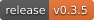
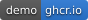
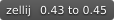
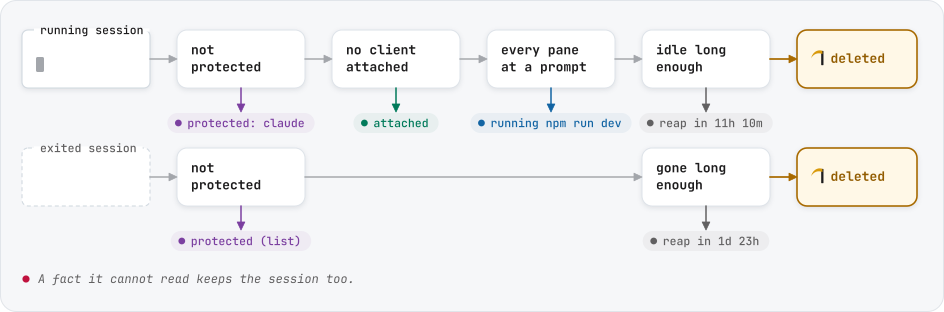
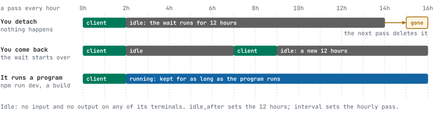

<p align="center">
  <picture>
    <source media="(prefers-color-scheme: dark)" srcset="docs/assets/logo-dark.svg">
    
  </picture>
</p>

<p align="center">
  <b>Deletes the zellij sessions you stopped using. Keeps the ones you use.</b><br>
  Once an hour it looks at every session: who is attached, what runs in its panes, when it was last used.
</p>

<p align="center">
  <a href="https://github.com/kanggu12/zellij-reaper/actions/workflows/ci.yml"></a>
  <a href="https://github.com/kanggu12/zellij-reaper/releases"></a>
  <a href="LICENSE"></a>
  <a href="https://github.com/kanggu12/zellij-reaper/pkgs/container/zellij-reaper-demo"></a>
  
  
</p>

<p align="center">
  <a href="#install">Install</a> |
  <a href="#what-goes-and-what-stays">What goes, what stays</a> |
  <a href="#names-that-say-what-a-session-is">Names</a> |
  <a href="#the-dashboard">Dashboard</a> |
  <a href="docs/README.md">Documentation</a> |
  <a href=".github/CONTRIBUTING.md">Contributing</a>
</p>

<picture>
  <source media="(prefers-color-scheme: dark)" srcset="docs/assets/screenshot-dark.png">
  
</picture>

zellij keeps every session until you delete it: the ones you detached from last week, and the exited ones it keeps
for resurrection. zellij-reaper runs from a systemd user timer and deletes the ones nobody uses. Every check has to pass
before a session goes; when a fact is unclear, the session stays.

## Why zellij-reaper

- **The session you are in stays.** A client in any terminal or a browser keeps its session, and zellij is asked again
  right before each delete.
- **Running jobs stay.** A build, `npm run dev`, `tail -f`, an editor or a job in the background keeps its session.
  Only a shell waiting at its prompt counts as idle.
- **Coding agents stay.** Claude Code, Codex, Gemini CLI, aider and opencode keep their session while they run, even at
  their prompt.
- **Names that say what a session is.** With `auto_rename = true`, `brave-peach` becomes `fix-the-login-bug`.
- **It shows why.** The dashboard shows every check with its evidence, and the log keeps one line per
  session, in words that stay the same across releases.
- **Light.** It runs as you, with no root and no network, and `plan` over ten sessions took 26 ms in the test container.

## What goes and what stays

<picture>
  <source media="(prefers-color-scheme: dark)" srcset="docs/assets/goes-dark.svg">
  
</picture>

The waits are yours to set: 12 hours idle (`idle_after`) and 3 days exited (`exited_after`) by default. Idle time
counts from the last input or output in any of the session's panes, so coming back to a session starts its wait over:

<picture>
  <source media="(prefers-color-scheme: dark)" srcset="docs/assets/when-dark.svg">
  
</picture>

To reap a session is to delete it (`zellij delete-session NAME --force`): it is gone with its scrollback and cannot be
resurrected. [How it decides](docs/how-it-decides.md) lists every check in order.

## Install

Linux or WSL 2, with zellij 0.43 to 0.45 and a systemd user instance (`systemctl --user` works):

```sh
curl -fsSL https://github.com/kanggu12/zellij-reaper/releases/latest/download/install.sh | sh
```

The script checks the download against the release's checksums, puts `zellij-reaper` in `~/.local/bin` and starts the
timer, with lingering so it runs after you log out too. The first pass comes ten minutes later, so there is time to
look first. This is `plan` on a machine set to `idle_after = "1h"`:

```
$ zellij-reaper plan
zellij-reaper · zellij 0.45.1 · reaping on · reaps after 1h idle, 3d exited · next pass 23:06

  SESSION         STATE    IDLE  CLIENTS  NEXT PASS
● old-experiment  exited   5d    –        reap
● scratch         running  3h    0        reap
● release-v2      running  50m   0        reap in 9m
● notes           running  1s    1        attached
● api-server      running  3h    0        running npm run dev
● agent-refactor  running  3h    0        protected: claude
● dotfiles        running  3h    0        protected (list)

  7 sessions · 2 to reap at the next pass · run `zellij-reaper` for the dashboard
```

`zellij-reaper protect NAME` keeps a session out of every pass. To start with passes that only log, run `zellij-reaper
config edit` and set `dry_run = true`. Packages (`.deb`, `.rpm`, `.apk`, Arch), release archives and `go install` are
in [setup](docs/setup.md), with upgrading, uninstalling, WSL 2 and [machines with no internet
access](docs/setup.md#without-internet-access).

## Try it in a sandbox

```sh
docker run --rm -it --init ghcr.io/kanggu12/zellij-reaper-demo
```

The dashboard opens on twelve sessions like the ones above, in a throwaway container. Reap, protect, rename and run
passes there as you like; your own sessions are not touched. Staging the sessions takes about a minute, and
`--init` lets ctrl+c out of it. Append `--shell` to the command for a shell in the same sandbox; put
`-e ZELLIJ_REAPER_LANG=ko` before the image name for Korean.

From a clone, `make demo` stages the same sessions from the working tree (it needs Go and Docker), and
`make demo DEMO_SHELL=1` opens its shell.

## Names that say what a session is

zellij names a session `brave-peach` when you do not. With `auto_rename = true`, every pass names such sessions after what
they show, so the list of sessions reads like a list of what you were doing:

<picture>
  <source media="(prefers-color-scheme: dark)" srcset="docs/assets/names-dark.svg">
  
</picture>

A name you chose stays: only the names zellij makes up and the ones a pass gave earlier change, and only when what the
session shows changes. The session you are in is renamed too; `auto_rename_attached = false` waits until nobody is
attached.

In the dashboard, `r` renames any running session, starting from the same suggested name, with `auto_rename` on or off.
`r`, Tab and Enter keep a running session's name as it is, such as a `quiet-mouse` you typed yourself, which looks made
up. [Setup](docs/setup.md#naming-sessions-after-what-they-show) has the rules.

## The dashboard

`zellij-reaper` opens it. Sessions are sorted by what the next pass does to them; the panel shows the checks for the
selected one with their evidence, its panes and the settings that apply.

| Key | Does | Key | Does |
|:---:|:---|:---:|:---|
| <kbd>↑</kbd> <kbd>↓</kbd> | select a session | <kbd>f</kbd> | run a pass now (asks first when it would reap) |
| <kbd>⏎</kbd> | attach (inside zellij 0.44 and later: switch to it) | <kbd>F</kbd> | run a pass without the idle and exited waits, after asking |
| <kbd>d</kbd> | reap it now, after asking | <kbd>l</kbd> | the decision log |
| <kbd>p</kbd> | protect it, or lift the protection | <kbd>/</kbd> | filter by name |
| <kbd>r</kbd> | rename it | <kbd>?</kbd> | every key and what each color means |

It speaks English, and Korean when the locale is Korean (`ZELLIJ_REAPER_LANG=en` or `ko` picks one).

## Commands

| Command | Does |
|:---|:---|
| `zellij-reaper` | the dashboard; the plan as a table when input or output is not a terminal |
| `tui` | the dashboard, always; it needs a terminal |
| `plan [--json]` | what the next pass would do, changing nothing |
| `run [--dry-run] [--force]` | one pass now, as the timer runs it |
| `logs [-n 50] [-f]` | the decision log |
| `protect NAME` / `unprotect NAME` | keep a session out of every pass, or let it go again |
| `install` / `uninstall [--purge]` | the systemd user timer |
| `config [show\|path\|init\|edit]` | the settings and where each value comes from |
| `doctor` | check zellij, systemd, lingering, the settings and the log |
| `recover [--dry-run] [--aggressive]` | repair sessions whose name is too long for their socket |
| `resize [--dry-run] [--shallow]` | make zellij and the programs in its panes redraw at the right size |

[Commands](docs/commands.md) has every flag and the `plan --json` shape.

## Settings

`install` writes `~/.config/zellij-reaper/config.toml` with every key at its default, commented out. Uncomment what you
change:

```toml
idle_after = "4h"            # reap idle sessions after 4 hours (default 12h)
exited_after = "1d"          # and exited ones after a day (default 3d)
protect = "^(keep-|work-)"   # names that are never reaped or renamed
auto_rename = true           # name the sessions zellij named after what they show
```

`zellij-reaper config show` prints the values in effect and where each one comes from. [Setup](docs/setup.md#settings)
lists every key.

## The log

Every pass writes one line per session:

```
$ zellij-reaper logs
11-05 11:49:05  === reaper start (dry_run=false idle_after=1h exited_after=3d) ===
11-05 11:49:05  old-experiment [EXITED] panes={Pane #1|sleep 5000} :: REAP EXITED, 5d since last activity
11-05 11:49:05    -> deleted: old-experiment
11-05 11:49:05  api-server [RUNNING] panes={Pane #1|npm run dev} :: SKIP running in a pane: npm run dev
11-05 11:49:05  notes [RUNNING] panes={Pane #1} :: SKIP client attached (1 client(s) attached)
11-05 11:49:05  quiet-mouse [RUNNING] panes={Pane #1|tail -f app.log} :: SKIP running in a pane: tail -f app.log
11-05 11:49:05    -> renamed: quiet-mouse → tail-app.log
11-05 11:49:05  release-v2 [RUNNING] panes={Pane #1} :: SKIP IDLE for 50m, reaped after 1h
11-05 11:49:05  === reaper end (1 reaped, 4 kept, 1 renamed) ===
```

It lives in `~/.local/state/zellij-reaper/` and moves to `reaper.log.1` past `log.max_bytes` (1 MiB).

## How it compares

| | zellij-reaper | `zellij delete-all-sessions` | `zellij kill-all-sessions` |
|:---|:---:|:---:|:---:|
| Exited sessions | deleted after a wait you set | deleted, all at once | left |
| Running sessions | deleted when idle, after a wait you set | with `--force`, all of them | stopped, all of them |
| A session with a client attached | kept | with `--force`, deleted | stopped |
| A session running a program | kept | with `--force`, deleted | stopped |
| Runs on its own | yes, from a user timer | no | no |
| Shows what it would do first | `plan`, the dashboard | no | no |

## Questions

**Will it delete the session I am in?** No. A session with a client attached is kept.

**My coding agent waits at its prompt for hours. Is its session safe?** Yes, while the agent runs; once it exits, the
normal wait applies. The programs in `protect_commands` keep their session even when the pane looks idle, and they are
found under any name they run as (`node .../claude-code/cli.js` counts as `claude`).

**What does it touch?** A pass:

<picture>
  <source media="(prefers-color-scheme: dark)" srcset="docs/assets/touches-dark.svg">
  
</picture>

**I used the earlier shell scripts.** `zellij-reaper install` moves them over: their settings, their log and their
dry-run setting. See [setup](docs/setup.md#coming-from-the-shell-scripts).

## Documentation

- [How it decides](docs/how-it-decides.md): a pass step by step, every check, the log's words.
- [Setup](docs/setup.md): installing, every setting, protecting and naming sessions, zellij versions.
- [Commands](docs/commands.md): every command and flag, the dashboard's keys and colors.
- [Troubleshooting](docs/troubleshooting.md): a timer that does not run, a session kept longer than you expect, a
  session nothing can delete.
- [Internals](docs/internals.md): the layers, how the facts are read, the design decisions, the tests.
- [Changelog](CHANGELOG.md): what changed in each release.

## Contributing

Bug reports with `zellij-reaper plan --json` and the log lines for the session help most.
[CONTRIBUTING.md](.github/CONTRIBUTING.md) covers how the code fits together, the tests (fake machines for the rules,
real zellij in containers) and what a change needs.

```sh
git clone https://github.com/kanggu12/zellij-reaper && cd zellij-reaper
make check        # gofmt, go vet, staticcheck, shellcheck, the unit tests
make integration  # real zellij releases in throwaway containers
```

## License

MIT ([LICENSE](LICENSE)). The libraries zellij-reaper is built from and the font its logo and figures are drawn from
are listed with their licenses in [THIRD_PARTY_NOTICES.md](docs/THIRD_PARTY_NOTICES.md).
