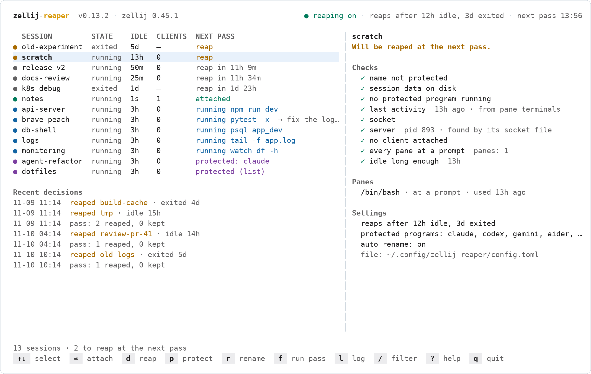

# zellij-reaper commands

`zellij-reaper --help` and `zellij-reaper COMMAND --help` say the same in short. Every command takes `--config FILE`.

## Looking

**`zellij-reaper`** opens [the dashboard](#the-dashboard) in a terminal. When its input or output is not a terminal, it
prints the plan as a table instead. **`zellij-reaper tui`** always opens the dashboard, and needs a terminal.

**`plan`** (also `status`, `ls`) shows what the next pass would do, changing nothing: no lock, no log, no deletes.
Each row is judged as of now, so a session whose wait ends in a few minutes says `reap in 4m`. The count under the
table is taken at the time the timer runs the next pass, as `install` and the setup screen count, so it includes that
session, and the count as of now follows when it differs: `2 to reap at the next pass · 1 due now`. That needs a
running timer that says when it runs next, which systemd, cron and the Task Scheduler do; launchd on macOS does not, so
there the count is as of now. A session without terminal times that no pass has found quiet yet (every session on
Windows, at first) is not in that count: the pass that first finds it quiet starts its wait. The table is sorted by
what happens to each session; `sessions` in the JSON keeps zellij's order. `--json` prints a shape
that stays stable for scripts; `reason` is the log's wording:

```json
{
  "generated": "2026-11-04T09:31:00+09:00",
  "dry_run": false,
  "idle_after": "12h",
  "exited_after": "3d",
  "sessions": [
    {
      "name": "scratch",
      "state": "running",
      "last_active": "2026-11-04T06:31:00+09:00",
      "idle_seconds": 10800,
      "clients": 0,
      "action": "reap",
      "code": "idle-old",
      "reason": "REAP IDLE, 3h since last activity",
      "server_pid": 4242,
      "panes": [{"pid": 4243, "command": "/bin/bash", "prompt": true}]
    }
  ]
}
```

`wait_seconds`, `server_pid`, `last_active`, `panes`, `would_rename` (with `auto_rename` on) and a pane's `busy` appear
only when they apply. In the table, a session the next pass renames shows `→ NEW-NAME` after its verdict, as room
allows. `clients` is -1 when it is not known, as on every exited session.

**`here`** prints the current name of this shell's zellij session, read from the process table and zellij's socket
files, with no zellij process; outside zellij, or when the name cannot be told, it prints nothing and exits
with status 1. A pane keeps the name its session had when the pane opened, in `ZELLIJ_SESSION_NAME`, and after a rename
a zellij command run there waits for a session by that name. **`shell-hook bash|zsh|fish`** prints a prompt hook that sets
`ZELLIJ_SESSION_NAME` from `here` at every prompt and keeps the status of the command before; see
[setup](setup.md#naming-sessions-after-what-they-show).

**`logs`** prints the last 50 lines of the decision log (`-n` for another number), colored by kind. `-f` keeps
printing new lines and follows the log across rotations. The lines are printed as they were written, in English, so
they can be searched and quoted; the dashboard's log view says them in its language.

**`doctor`** checks zellij and its version, the timers' service (systemd, launchd or the Task Scheduler), the timer
(installed, enabled, running this binary, the interval it was installed with), the names timer when `auto_rename` is
on, lingering on Linux, the settings, settings that only your shell sees, zellij's session directory, how renamed
sessions are matched to their servers, the log and the last pass. The last pass is read from the log: when it ran and
what it did, with how many deletes zellij refused, or why it stopped, and whether the passes stopped coming or
something holds the pass lock, which makes
every pass give up. Under a timer, a pass that gives up on the lock ends with status 0, and one that stops says why only
in the log: this is where both show. It exits with status 1 when something is broken; a warning alone still exits 0.

## Acting

**`run`** runs one pass now, as the timer does, and prints a table of what it did, with the totals. `--dry-run` only
logs; `--force` sets both waits to zero for this pass; `--names-only` renames what a pass would and deletes nothing,
writing to the log only when it renames (the names timer's mode); `--quiet` prints nothing (the timers' mode). The exit
status is 0 when the pass ran, when another pass holds the lock, or when zellij is missing. It is 1 when zellij
refused a delete, with a line saying how many, also under `--quiet`, so the timer's own status shows it; and 1 on any
other error, such as zellij failing to list its sessions. A session kept at the last moment, or a rename zellij
refused, is no failure.

**`protect NAME...`** adds sessions to the protected list; with no name it prints the list, one name a line (in a
terminal, an empty list says so). **`unprotect NAME...`** takes them off, and says when a name was not on the list. A
name the `protect` pattern matches stays protected either way, and `unprotect` says so.

**`keep-name NAME...`** keeps running sessions' names as they are, as `r`, Tab and Enter do in the dashboard: no pass
renames them. With no name it prints the kept names. **`forget-name NAME...`** takes names off that list, so passes may
rename those sessions again. Both wait for a pass that holds the lock, and log what they did.

**`delete NAME...`** reaps sessions now, as <kbd>d</kbd> does in the dashboard, with its checks: a session with a client
attached, one whose clients nobody can tell, or one not in the list of sessions is kept, going by a plan made just
before and by zellij asked once more right before the delete. Each is asked about first with the dashboard's question,
which says what protects it or still runs in it, and checked again after the answer; `--yes` (`-y`) reaps without
asking, and without a terminal to answer in, `delete` needs it. The waits do not apply. The exit status is 1 when any
session it was not told to keep was kept. Each delete is a line in the log, `NAME :: deleted from the command line`,
and shows among the dashboard's recent decisions.

**`rename NAME NEW-NAME`** renames a running session, as <kbd>r</kbd> does in the dashboard. A name given by hand is
someone's choice, so passes leave it alone, and a protection follows the session to its new name. A name too long for
the socket path or taken by another session is refused, and so is an exited session; renaming a session to the name it
has keeps that name, as `keep-name` does. zellij on Windows cannot reach a session after a rename, so `rename` refuses
there.

Every change the dashboard makes is a command too: <kbd>f</kbd> is `run`, <kbd>F</kbd> `run --force`, <kbd>p</kbd>
`protect` or `unprotect`, <kbd>d</kbd> `delete`, <kbd>r</kbd> `rename` or `keep-name`. What it shows is `plan` (the
table) and `logs` (<kbd>l</kbd>).

**`recover [--dry-run] [--aggressive]`** repairs sessions that no zellij command can reach. A session's name is part
of its socket path, which Linux caps at 107 bytes and macOS at 103; a session renamed past that keeps a server nobody
can talk to, and its files come back after every delete. `recover` deletes such sessions and clears their files.
`--aggressive` also stops servers that serve no socket file at all, unless a client is still connected to one, a pane
in it is busy, a protected program runs in it, its name is protected, or any of that cannot be read; it looks once
more just before each stop. A renamed session's server still serves its socket and is left alone. Without
`--aggressive`, a run that finds servers the flag would stop ends by saying how many there are and which command stops
them. A real run takes the pass lock and writes each thing it does to the [log](how-it-decides.md#the-log) as it does
it; `--dry-run` changes nothing and logs nothing. When zellij's session index cannot be read, no session can be told
from another, and `recover` changes nothing. The exit status is 1 then, and when a step failed, each said on its
line.

**`resize [--dry-run] [--shallow]`** (also `refresh`) sends `SIGWINCH` to every zellij client, every server and every
program in a pane, so each one reads its terminal size again. Use it when a program is stuck at an old size after the
window changed. `--shallow` signals the clients only. The exit status is 1 when a process could not be signalled.

## Setting up

**`setup`** opens the setup screen: what the first pass would reap, with the idle and exited waits, the mode (reap, or
only log what it would reap), names and the prompt hook to choose with the arrow keys, and the listed sessions to keep
with <kbd>space</kbd>.

- <kbd>⏎</kbd> writes the choices into the settings file, leaving its other lines as they are, puts the kept sessions on
  the protected list, adds the hook to the shell's startup file and runs `install`.
- <kbd>esc</kbd> changes nothing; opened by an install script, it keeps the defaults and the install goes on.
  <kbd>ctrl+c</kbd> stops there either way, with status 130, so an install script that opened the screen says the timers
  are not running.
- The install scripts open it on a first install in a terminal. With no settings file, `zellij-reaper` opens it
  instead of the dashboard.

With any of these flags, `setup` opens no screen and needs no terminal: the flags are the choices, what they leave out
stays as the settings have it, and then it does what <kbd>⏎</kbd> does. Each value is checked before anything is
written.

| Flag | Sets |
|:---|:---|
| `--idle-after 4h` | `idle_after` |
| `--exited-after 1w` | `exited_after` |
| `--dry-run`, `--dry-run=false` | `dry_run`: only log, or reap |
| `--auto-rename`, `--auto-rename=false` | `auto_rename` |
| `--hook` | adds the prompt hook to the startup file of the shell in `$SHELL` (bash, zsh, fish), once |
| `--protect NAME` | puts sessions on the protected list; repeat it, or separate names with commas |

```sh
zellij-reaper setup --idle-after 4h --exited-after 1w --dry-run --protect api,notes
```

**`install`** writes a settings file and the timers, the systemd units with lingering on Linux (crontab lines where
systemd has no user instance but cron runs), the launch agents on macOS and the scheduled task on Windows, and says
when the first pass runs. **`uninstall`** removes the timers, also when the settings file does not load; `--purge` also
removes the settings, the log, the protected list and the lists of given and kept names, and takes the prompt hook
`setup` added out of the shells' startup files. Both list what they removed and name what they left; the program
itself stays. See [install](setup.md#install) and [uninstall](setup.md#upgrade-and-uninstall).

**`config`** has four subcommands: `show` (the default) prints every setting with where its value comes from, `path`
prints the file's path, `init` writes the file with every key at its default, and `edit` opens it in `$VISUAL` or
`$EDITOR` (or `vi`, Notepad on Windows) and refuses a value it cannot read or a key it does not know.

**`version`** prints the version; **`completion bash|zsh|fish|powershell`** prints a completion script.

## The dashboard

<picture>
  <source media="(prefers-color-scheme: dark)" srcset="assets/screenshot-dark.png">
  
</picture>

The top bar shows the name and this build's version (for a build from source, `dev` and the commit), zellij's version,
whether passes delete (`reaping on`) or only log (`dry run`), both waits (`reaps after 12h idle, 3d exited`) and when
the timer runs next. The table has a row per session: its state, how long it has been idle, its clients, and what the
next pass does to it. Rows are sorted by outcome: deleted, waiting, unclear, attached, busy, protected. The panel beside
it (below it on terminals under 132 columns) explains the selected session: the verdict in a sentence, every check with
its evidence and where it came from, its panes, the name the next pass gives it, or that its name is kept, with the
`forget-name` command that lets it go, and the settings that apply. Under a short table, the latest reaps, renames and
kept names fill the column.

The color of a row says what will happen to it:

| Color | Means |
|:---:|:---|
| yellow | due now: deleted at the next pass |
| grey | idle, waiting out `idle_after` or `exited_after`; one whose wait ends before the next pass is in that pass's count |
| blue | a program runs in it |
| green | a client is attached |
| violet | protected, by name or by a running program |
| red | a fact could not be read, so it is kept |

| Key | Does |
|:---:|:---|
| `↑` `↓`, `k` `j` | select a session |
| `g` `G`, `PgUp` `PgDn` | first, last, a page up or down |
| `⏎` | attach to it; inside zellij, switch this client to it (zellij 0.44 and later: 0.43 has no command for that) |
| `d` | reap it now, after asking (the question names what still runs in it); refused while a client is attached or zellij cannot say |
| `p` | protect it, or lift the protection |
| `r` | rename it; the field starts with [the name its panes point to](setup.md#naming-sessions-after-what-they-show), and `⇥` swaps it with the name the session has. A name that is taken is refused, and an exited session cannot be renamed |
| `f` | run a pass now; it asks first when the pass would delete something (a dry run deletes nothing, so it does not ask) |
| `F` | run a pass without the idle and exited waits, after asking |
| `l` | the decision log: `↑` `↓` scroll, `f` follows new lines, `esc` or `q` returns |
| `/` | filter by name as you type: `⏎` keeps the filter, `esc` puts back the old one |
| `esc` | clear the filter; it never quits |
| `R` | read the sessions again now |
| `?` | every key and what each color means, beside the logo and the version |
| `q`, `ctrl+c` | quit |

To keep a running session's current name, press `r`, `⇥` and `⏎`: passes leave it alone from then on.

The dashboard reads the sessions every five seconds. `d`, `r`, `f` and `F` take the pass lock and go to the decision
log, like a pass's work; `p` changes the protected list under that list's own lock and is not logged. It speaks English,
and Korean when `LC_ALL`, `LC_MESSAGES` or `LANG` starts with `ko`; `ZELLIJ_REAPER_LANG=en` or `ko` picks one. The
colors follow the terminal's background, and `NO_COLOR` turns them off.
