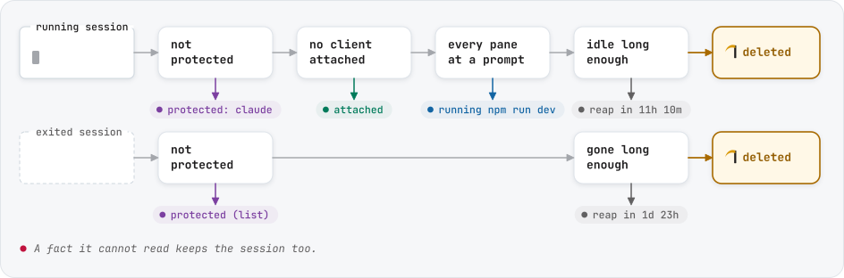
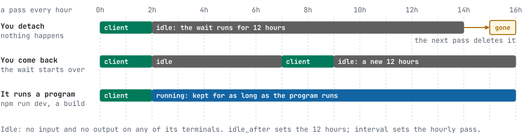
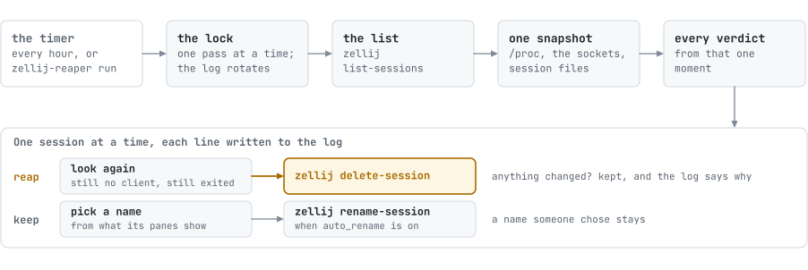
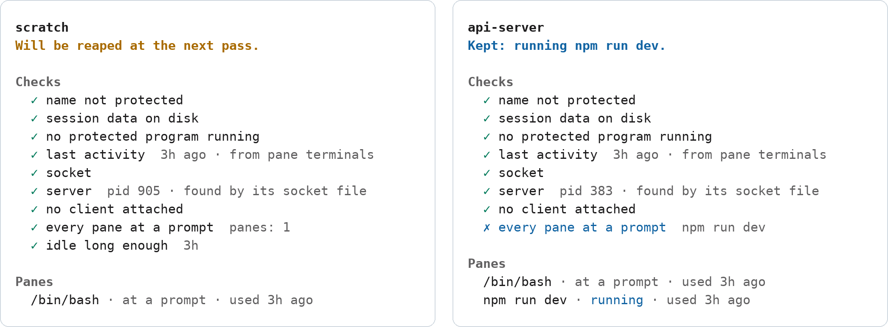

# How zellij-reaper decides

A pass deletes a session only when every check below has passed on a fact it could read. A fact it cannot read keeps
the session: keeping a session one more hour costs nothing, deleting one in use cannot be undone.

## In short

<picture>
  <source media="(prefers-color-scheme: dark)" srcset="assets/goes-dark.svg">
  
</picture>

Idle time counts from the last input or output on any of the session's terminals, so coming back to a session starts
its wait over:

<picture>
  <source media="(prefers-color-scheme: dark)" srcset="assets/when-dark.svg">
  
</picture>

## A pass, step by step

<picture>
  <source media="(prefers-color-scheme: dark)" srcset="assets/pass-dark.svg">
  
</picture>

1.  **Takes the pass lock.** The timer, `zellij-reaper run` and the dashboard's actions share one lock, so two of them
   never act at once. A pass waits 30 seconds for it, a dashboard action two and a names pass one, then leaves the work
   to whoever holds it. The protected list is read again once the lock is held.
2. **Rotates the log** to `reaper.log.1` if it has grown past `log.max_bytes`, so a pass never spans two files.
3. **Lists the sessions** with `zellij list-sessions --no-formatting`. zellij answers "No active zellij sessions found."
   with the same exit status as an error; the pass tells the two apart and logs `no sessions`.
4. **Reads the machine once:** one snapshot of the process table (`/proc` on Linux), one of the kernel's Unix socket
   table (Linux), and each session's files in zellij's cache directory. Every session in the pass is judged against the same moment.
5. **Tells who is attached** from that socket table. Only a session the table cannot answer for is asked, with
   `zellij action list-clients`, one at a time. macOS and Windows have no such table, so every running session is
   asked there, except one renamed by hand on Windows, which zellij cannot reach.
6. **Decides every session** with the checks below, all from that one snapshot.
7. **Goes through the sessions one at a time** and logs each one's line. Just before it deletes a session, it looks
   again: at a running session's clients, and at its panes for a job started since; at whether an exited one is still
   listed as exited; and at the protected list. Anything that changed keeps the session, logged as
   `-> kept: NAME :: reason`. Otherwise it runs `zellij delete-session NAME --force` for a running session, and
   `zellij delete-session NAME` for an exited one, which zellij refuses if someone brought it back meanwhile. A pass
   starts no delete after 40 seconds, its wait for the lock included, and leaves the rest to the next; every call it
   makes to zellij ends by 50 seconds, so it ends before the minute systemd and the Task Scheduler give it.
8. **Renames a session it kept** when `auto_rename` is on, its name is not one someone chose, and its panes, or the
   project its coding agent works in, point to another name. With `auto_rename_attached = false`, it renames only
   sessions nobody is attached to, and asks the session for its clients once more first. zellij moves a renamed
   session's files to the new name, then tells the job that writes them every second, and a write in between makes the
   old name's folder again: zellij then lists an exited session under the old name, a copy that attach would bring back.
   So once the pass has been through its sessions, at least 1.5 seconds after its last rename, it deletes an exited
   session under a name it renamed a session away from, with `zellij delete-session NAME`, never `--force`, and without
   the `exited_after` wait: until the rename the name was the renamed session's own, so no other session had it. It
   keeps such a copy when its name is protected, by the protect pattern in the settings it read or by the protected list
   read again, and a protected copy stays as any protected session does. It keeps one whose files were written more than
   1.5 seconds after the rename, which someone brought back meanwhile; those times are the file system's, so a clock set
   back, or a network file system whose clock is off from this machine's, can blur the two. It keeps one zellij refuses
   because it runs again, and starts no such delete past its 40 seconds. A copy zellij writes after the look, or one the
   pass does not get to, waits like any exited session. A rename in the dashboard or with `rename` looks the same way,
   under the lock, once it has said the rename is done; it moves the protected list's entry to the new name, so there
   only the pattern protects the old name. Closed or stopped within those 1.5 seconds, it leaves the copy to wait like
   any exited session.

A dry run (`dry_run = true`, or `run --dry-run`) does steps 1 to 6, and in steps 7 and 8 only logs what it would do.
`plan` and the dashboard do steps 3 to 6 only: no lock, no log, no change.

The names timer runs `run --names-only` every `rename_interval` (5 minutes): steps 1, 3 to 6 and 8, and step 2 only when
it renames something, so a name follows its session sooner than the hourly pass. It deletes nothing but such a copy,
writes down where coding agents work (`projects`), writes to the log only when a name changed, does nothing in a dry
run, and leaves dropping tails (`auto_rename_drop_tail`) to the hourly pass.

## The checks

They run in this order, and the first check that matches decides. Its code is what `plan --json` reports and what the
dashboard's detail panel marks with ✗.

<picture>
  <source media="(prefers-color-scheme: dark)" srcset="assets/checks-dark.png">
  
</picture>

| Code | Matches when | Log line |
|:---:|:---|:---|
| `protected-name` | the name matches `protect`, or is on the protected list | `SKIP protected by protect pattern`, `SKIP protected by protected list` |
| `name-unknown` | zellij's session index is there but cannot be read, so the name, and whether it is protected, cannot be told: zellij then lists the sessions it keeps by id under their ids | `SKIP name unknown (zellij's session index cannot be read)` |
| `no-info` | zellij has written nothing about the session yet | `SKIP no session_info dir (unknown state)` |
| `exited-live` | listed as exited, but a server still listens on its socket | `SKIP EXITED, but a server still serves it (pid 123)` |
| `protected-command` | a program from `protect_commands` runs in it, or its layout starts one | `SKIP protected command running (claude)` |
| `no-activity` | the time of its last use cannot be read | `SKIP cannot read activity time` |
| `exited-recent` | exited less than `exited_after` ago | `SKIP EXITED 5h ago, reaped after 3d` |
| `exited-old` | exited `exited_after` ago or more: **deleted** | `REAP EXITED, 4d 2h since last activity` |
| `no-socket` | a running session has no socket file | `SKIP socket file missing for running session` |
| `no-server` | no server process serves its socket | `SKIP server PID not found` |
| `attached` | a client is attached | `SKIP client attached (1 client(s) attached)` |
| `attach-unknown` | whether one is attached cannot be told | `SKIP attach-check uncertain (...)` |
| `no-panes` | the server has no pane processes: it is starting or stopping | `SKIP server has no pane processes (transient)` |
| `busy` | a pane runs anything but a shell at its prompt | `SKIP running in a pane: htop` |
| `idle-recent` | idle for less than `idle_after` | `SKIP IDLE for 12m, reaped after 1h` |
| `idle-old` | idle `idle_after` or more: **deleted** | `REAP IDLE, 2h 14m since last activity` |

`plan` and the dashboard's NEXT PASS column put each code in fewer words:

| Code | In `plan` |
|:---:|:---|
| `protected-name` | `protected (list)` or `protected (pattern)` |
| `name-unknown` | `name unknown` |
| `no-info` | `no session data yet` |
| `exited-live` | `exited, server still up` |
| `protected-command` | `protected: claude` |
| `no-activity` | `last use unknown` |
| `exited-recent`, `idle-recent` | `reap in 34m` |
| `exited-old`, `idle-old` | `reap` |
| `no-socket` | `socket missing` |
| `no-server` | `server not found` |
| `attached` | `attached` |
| `attach-unknown` | `attach state unknown` |
| `no-panes` | `starting or stopping` |
| `busy` | `running htop` |

`exited-live` applies only to exited sessions, `protected-command` only to running ones. An exited session stops at
`exited-recent` or `exited-old`: it has no socket, server, clients or panes left to check.

`run --force` (`F` in the dashboard) sets both waits to zero for one pass. Every other check still applies.

## Where each fact comes from

- **The project a coding agent works in** is the git repository its newest command works in: the one the command's
  processes name in their command lines (`/proc/<pid>/cmdline`, paths in full or under `~/`, not under the home's hidden
  folders), else the one they run in (`/proc/<pid>/cwd`, and on macOS `lsof`; Windows tells no process's directory, and
  nothing is renamed there); two repositories named as often say nothing. A repository is the first `.git` at or above a
  directory, looking no higher than the home directory, a worktree counting as the repository it was made from. Each
  child of the agent's process is one command, with what runs under it, and counts from when it started. A pass counts
  the newest when it started after the last one counted; two counted in a row in one repository settle it, four
  elsewhere move it, and it is kept between commands ([naming](setup.md#naming-sessions-after-what-they-show)).
- **Last use** of a running session is the newest read or write time of its panes' terminals (`/dev/pts/N`). The kernel
  moves it on input and output only, so a redraw or zellij's own bookkeeping does not count. Exited sessions use their
  files in zellij's cache, which stopped changing when the server ended. Where no terminal can be read, which is every
  session on Windows, a running session is idle from the later of the first pass that found it quiet (no client,
  every pane at a prompt) and the last change of its files, which zellij rewrites when a client attaches or leaves.
  The files alone do not change when a pane prints. The first quiet pass is kept in the state directory (`quiet`),
  and such a session can go up to one interval late.
- **Attached clients** come from the kernel's socket table on Linux: each connection a server accepted, with its other
  end still open, is one client. When the table cannot tell, and always on macOS and Windows, `zellij action list-clients` asks the server itself, and when the
  server does not answer, the count zellij writes to its metadata file can add a client. Browser clients (zellij's web
  client) always count.
- **Busy panes.** Each pane is a child process of the session's server with a controlling terminal; a server's other
  children, like the `ps` zellij runs to save its layouts, are not panes. A pane is at a prompt when it is a known shell
  (`bash`, `zsh`, `fish`, `nu`, `pwsh`, `cmd` and others, plus `shells`), started without a script, with no child
  process. On Windows the console host each pane runs behind is not a pane. A command in
  the foreground or the background, or a program the pane runs itself (`zellij run`, a command pane from a layout), makes
  it busy, and so does a job with its input redirected (`nohup`).
- **Protected programs** are looked for in every process under the server and in the commands of the saved layout. A
  program matches by its process name, its executable's name or the script an interpreter runs, as a whole word:
  `node .../claude-code/cli.js` matches `claude`, `claudette` does not.
- **The server** is found from the socket file. On Linux its inode leads, through the kernel's socket table, to the
  process listening on it; on macOS its creation time matches the server that started then; on Windows the file holds
  the server's process ID. zellij keeps a server's command line when its session is renamed, so this is what finds
  renamed sessions. Without such a match (a Linux kernel without `unix_diag`, or on macOS two servers started less than
  about 0.1 s apart) a renamed session is kept as `no-server`. The command line is what is left then, and it names the
  socket a server started with: once any session has been renamed, that name may be another session's, so no server is
  found by it and every running session is kept as `no-server` until the sessions renamed have ended.

## The log

`~/.local/state/zellij-reaper/reaper.log` (`%LOCALAPPDATA%\zellij-reaper\reaper.log` on Windows): a start line with the settings of the pass, one line per session with its
state and pane titles, an arrow line for each thing done, and an end line with the counts.

```
[2026-11-04 09:31:00] === reaper start (dry_run=false idle_after=12h exited_after=3d) ===
[2026-11-04 09:31:00] api-server [RUNNING] panes={npm run dev} :: SKIP running in a pane: npm run dev
[2026-11-04 09:31:00] scratch [RUNNING] panes={Pane #1} :: REAP IDLE, 13h 2m since last activity
[2026-11-04 09:31:00]   -> deleted: scratch
[2026-11-04 09:31:00] === reaper end (1 reaped, 1 kept, 0 renamed) ===
```

Every line the log can hold:

| Line | Written when |
|:---|:---|
| `=== reaper start (dry_run=... idle_after=... exited_after=...) ===` | a pass starts; ` force` follows `exited_after` for `run --force` |
| `could not rotate PATH (N bytes) to PATH.1: ERROR` | the log could not move aside; the pass goes on |
| `could not read the list of kept names: ERROR, so no session is renamed` | with `auto_rename` on, the list of kept names could not be read; the pass goes on and renames nothing |
| `zellij on Windows cannot reach a session after a rename: its pipe keeps the first name, so no session is renamed` | with `auto_rename` on, on Windows; the pass goes on and renames nothing |
| `read zellij's session index PATH: ERROR, so every session is kept`, `zellij's session index PATH has no name column, so every session is kept` | the index a zellij newer than 0.45 keeps its sessions' names in is there but could not be read; no session's name can be told for sure, so each is kept as `name-unknown` |
| `NAME [RUNNING] panes={TITLES} :: VERDICT` | a session is decided; `[EXITED]` for an exited one |
| `  -> deleted: NAME` | the session was deleted |
| `NAME [EXITED] :: copy zellij left when it renamed the session to NEW` | after a rename, zellij listed the old name as an exited session, a copy of the renamed one (step 8); the next line says what came of it |
| `  -> deleted the copy: NAME` | that copy was deleted |
| `  -> could not delete the copy: NAME :: ERROR` | zellij refused; the copy waits like any exited session, and it is no failure of the pass |
| `  -> FAILED: NAME :: ERROR` | zellij refused the delete, or the session was still running five seconds later |
| `  -> kept: NAME :: REASON` | something changed just before the delete: a client attached, a job started in a pane, the name was protected, an exited session runs again; for a copy, its name is protected, its files were written since the rename or could not be found or read, the protected list could not be read again, or the pass's 40 seconds were up |
| `  -> renamed: OLD → NEW` | `auto_rename` renamed a survivor |
| `  -> kept name: NAME :: REASON` | the name was protected just before the rename, or a client attached (with `auto_rename_attached = false`), so the session keeps its name for now |
| `  -> could not record the name NAME: ERROR` | the list of given names could not be written; the rename goes on, and the session keeps that name until someone changes it |
| `  -> rename FAILED: OLD → NEW :: ERROR` | zellij refused the rename, or took it without listing the new name in time |
| `  -> rename gave up: OLD → NEW (too many collisions)` | every numbered name was taken |
| `  -> DRY_RUN: would run: zellij delete-session NAME --force`, `  -> DRY_RUN: would rename 'OLD' → 'NEW'` | a dry run; an exited session is deleted without `--force`, so a session brought back meanwhile is refused rather than killed |
| `time is up after 40s: N sessions left for the next pass` | a pass that has run 40 seconds, its wait for the lock included, starts no more deletes and leaves the sessions it has not come to; a names pass says `time is up after 40s: the rest are named at the next pass`. systemd and the Task Scheduler stop a pass at a minute, and one stopped that way writes no end line |
| `time is up after 40s: no look for copies zellij may have left under old names` | the pass renamed a session too close to its 40 seconds to wait for zellij; a copy left waits like any exited session |
| `could not look for copies zellij left under old names: ERROR` | after a rename, zellij did not list its sessions, or after a rename by hand the lock could not be taken, held by a pass or not to be opened; a copy left waits like any exited session |
| `no sessions` | zellij lists none |
| `zellij not installed, nothing to do` | zellij is not on the service's `PATH` |
| `zellij list-sessions failed: ...`, `could not inspect the sessions: ...`, `could not read the protected list: ...` | the pass stops without acting. When zellij gave no answer and a server is stopped, the line names it: ``...; the server of NAME (pid N) is stopped: `kill -CONT N` lets it go on``, or ``the servers of NAME (pid N) and NAME (pid M) are stopped: `kill -CONT N M` lets them go on`` |
| `could not write PATH: ERROR` | the file of first quiet passes (`quiet`) or of agents' projects (`projects`) could not be written. A session this pass was the first to find quiet starts its wait again at the next pass; an agent's command this pass counted is forgotten, so its session may follow the agent later |
| `=== reaper end (N reaped, N kept, N renamed) ===` | a pass ends; just `=== reaper end ===` after a pass that stopped early |
| `=== names start ===`, `=== names end (N renamed) ===` | around the renames of a names pass; a names pass that changes no name writes no line, not even a failure |
| `NAME :: deleted from the dashboard`, `NAME :: renamed from the dashboard to NEW`, `NAME :: name kept from the dashboard` | done by hand in the dashboard |
| `NAME :: deleted from the command line`, `NAME :: renamed from the command line to NEW`, `NAME :: name kept from the command line`, `NAME :: name no longer kept, from the command line` | `delete`, `rename`, `keep-name` and `forget-name` |
| `NAME :: recover: deleted with zellij`, `NAME :: recover: removed DIR` | `recover` deleted a broken session and cleared its files; `recover --dry-run` writes no line |
| `NAME :: recover: zellij could not delete it: ERROR`, `NAME :: recover: could not remove DIR: ERROR`, `NAME :: recover: skipped: name is not a plain directory name` | a step of that did not go through; zellij often cannot delete a session it cannot reach, and the files are cleared all the same |
| `pid N (first name: NAME) :: recover: stopped orphan server`, `... :: recover: stopped orphan server (SIGKILL)` | `recover --aggressive` stopped a server that serves no socket file, with `SIGKILL` when it was still there a second after `SIGTERM`; the brackets hold `name: NAME` where zellij's index still names the session, `first name: NAME` for the name it started under, or `name unknown` |
| `pid N (...) :: recover: kept orphan server: REASON` | the look right before the stop found a reason to keep the server |
| `pid N (...) :: recover: could not stop orphan server: ERROR`, `... :: recover: could not stop orphan server (SIGKILL): ERROR` | the signal was refused |
| `servers :: recover: not stopped: every server looked orphaned, which points at the socket table` | `recover --aggressive` repaired a broken session and stopped no server: with more than one server and not one of them serving a socket file, the socket table is what looks wrong. With no broken session either, recover changes nothing and writes no line |

The words stay the same across releases, so months of the log can be grepped. New kinds of lines may be added.
`zellij-reaper logs -f` follows it across rotations; with `tail`, use `tail -F`.
