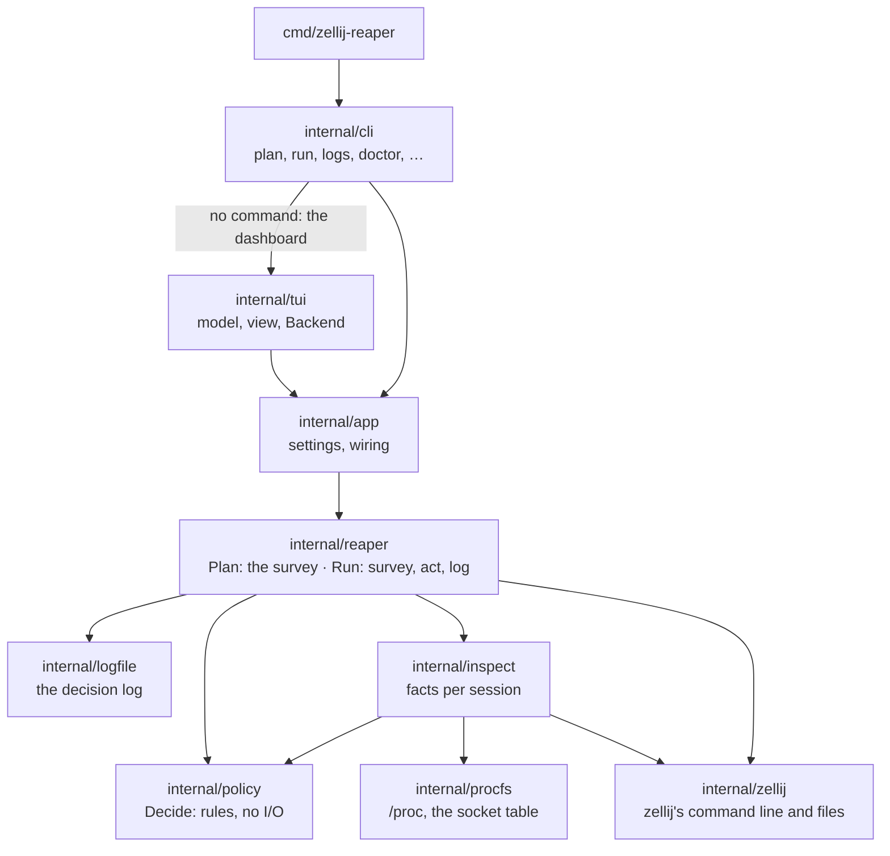
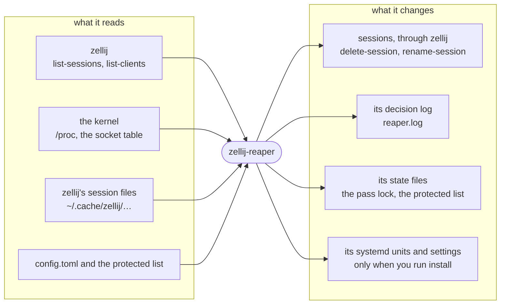

# zellij-reaper internals

How the code is laid out, how it reads the machine, why it reads what it reads, and how it is tested. For what a pass
does from the outside, see [how it decides](how-it-decides.md).

## Layout



| Package | Holds |
|:---|:---|
| `internal/policy` | `Decide(facts, thresholds, now)`: the rules, with no I/O; every rule is a row in a table test |
| `internal/inspect` | the facts for every listed session, from one snapshot |
| `internal/procfs` | one read of `/proc`, and the kernel's Unix socket table over netlink (sock_diag) |
| `internal/zellij` | zellij's command line (`list-sessions`, `list-clients`, `delete-session`, rename) and its session files |
| `internal/reaper` | `Plan`, the survey alone, and `Run`, the only code that changes anything |
| `internal/rename` | names from pane titles, within the socket path's byte budget |
| `internal/logfile`, `internal/lock`, `internal/protect` | the decision log, the pass lock (`flock`), the protected list |
| `internal/config`, `internal/systemd` | settings, XDG paths, the user timer, moving the shell scripts over |
| `internal/repair`, `internal/resize` | `recover` and `resize` |
| `internal/ui`, `internal/i18n` | colors, the session table and the words for verdicts, shared by the CLI and the dashboard; English and Korean |
| `internal/testutil` | fake machines for tests: a `/proc`, terminals with chosen times, real Unix sockets, session files |

## Reading the machine

A pass reads four things and changes a few of its own; the only sessions it touches go through zellij's own commands.



`reaper.Plan` and `reaper.Run` share one survey: list the sessions, take one snapshot of `/proc` and one of the
socket table, read each session's files, ask each running server for its clients, then decide. `policy.Decide`
returns the action, a code, the evidence, how long the session still has to wait, and the checks in the order they
ran, ending with the one that decided. The log, `plan --json` and the dashboard each put that one verdict into their
own words.

| Fact | Read from | Why there |
|:---|:---|:---|
| sessions, exited or not | `zellij list-sessions --no-formatting` | zellij's own list; a name is everything before ` [Created`, so names with spaces survive |
| server and socket | the socket file's inode in the socket table, then `/proc/*/fd` | finds renamed sessions ([below](#renamed-sessions)) |
| panes | the server's child processes | zellij forks one process per pane |
| busy | a pane process that is not a shell at its prompt, or a shell with a child | [below](#busy-panes) |
| last use | the newest change time of the panes' terminals | [below](#last-use) |
| attached | `zellij action list-clients` | [below](#attached-clients) |
| protected program | every process under the server, and the commands of the saved layout | an agent runs as `claude`, `node .../claude-code/cli.js`, or a script |
| exited time | the newest change time in the session's `session_info` directory | frozen when the server ended |

## Decisions

### Fail closed

Every check keeps the session when its fact is missing or uncertain: no session directory, no socket, no server, an
attach check that failed, no pane processes. The rules delete only when every check passed with a fact in hand.

### Last use

The time of last use is the newest change time of the panes' terminals, which the kernel moves on input and output
only. zellij's session files are a poor clock for a running session: zellij rewrites `session-metadata.kdl` about
once a minute whatever happens, which once made every session look used "0h" ago. They are the clock for exited
sessions, whose files stop changing when the server ends.

### Attached clients

`zellij action list-clients` asks the server about this moment. The count in `session-metadata.kdl` lags: in the
integration containers, a session made with `attach --create-background` still had `connected_clients 1` ten seconds
later on 0.45.1, and on 0.43.1 kept it until something else happened in the session. Trusting the file first kept such
sessions forever on 0.43 and for up to a minute on 0.44 and 0.45. So `list-clients` comes first, the file only when the
server does not answer, then the socket table: a connection to the server held by another process is a client.
Browser clients are counted from the file as well, so a session open in a browser is never taken for an idle one.

### Renamed sessions

When a session is renamed, zellij renames its socket file but keeps the server's command line (`--server
<first-name>`), and the kernel keeps the path the socket was bound to. Matching servers by command line, as the
shell scripts did, loses every renamed session: six months of the author's shell-version log hold 929
`server PID not found` verdicts on sessions it had renamed itself, none of which could ever be deleted.

The socket file's inode follows the rename. sock_diag (what `ss -x` reads) reports for each listening socket the inode
of its file (`UNIX_DIAG_VFS`), and `/proc/<pid>/fd` shows which process holds the socket. `internal/procfs` asks the
kernel over netlink, so `ss` is not needed. The device number in `UNIX_DIAG_VFS` uses the kernel's own encoding
(`major << 20 | minor`), not the one `stat(2)` returns. Without `unix_diag` the command line is the fallback and
renamed sessions are kept as `no-server`.

The same matching lets `recover` tell a real orphan (a server whose socket file is gone) from a renamed session. The
shell version's `recover --aggressive` took every server whose first name had no file for an orphan, which includes
every renamed session. An orphan is still stopped only when no client is connected to it, no pane is busy, and
neither a protected program nor a protected name keeps it.

### Busy panes

A pane is idle when its process is a known shell by both its kernel name and its executable, started without a
script, with no child process. The shell scripts checked only for children, so a pane that runs a program directly
(`zellij run -- htop`, a command pane from a layout, where the program is the pane's process) looked idle. A script
started from its shebang has the script's name as its kernel name, so it is not taken for a shell either.

### zellij's directories

zellij 0.44 moved its socket and data directories from a version-named one (`0.43.1`) to `contract_version_1`. The
version from `zellij --version` picks the directory, taking the highest `contract_version_N` present for later
releases. Running servers name their socket on their command line, so the socket directory is taken from them
whenever one runs.

### Names and the socket path

A session's name is part of its socket path, and Linux caps a socket path at 107 bytes. Early shell versions cut names
at 50 characters, which for Korean titles is 150 bytes; renamed past the limit, a session kept a server no command
could reach. Names are now cut by bytes, at a character boundary, to what the session's own socket directory leaves,
with room for the stamp and a collision suffix. `recover` repairs sessions broken the old way.

### The log

The log's words are an interface: people grep months of it. The verdict texts (`REAP IDLE`, `SKIP client attached`,
...) and the `=== reaper start/end ===` lines stay fixed; new kinds of lines may be added. The log rotates by
renaming at the start of a pass, under the lock, so a pass is never split across the two files, and a rename that
fails is written into the log instead of stopping the pass.

### One lock, and a second look

The timer, `zellij-reaper run`, `recover` and the dashboard's actions take the same `flock`; a pass that cannot get it
within five seconds (two for a dashboard action) leaves the work to the one that holds it. A pass gathers every fact
first and then acts one session at a time, and each delete can take a moment, so it asks again just before each
delete and each rename. The dashboard asks too before a delete by hand. Someone who attached in between keeps the
session.

### The dashboard

The model holds the last plan and draws from it; every five seconds it asks its `Backend` for a new one. All I/O sits
behind `tui.Backend`, so the tests drive the real model with a fake backend.

## Tests

A change comes with a test that fails without it. A bug report becomes a test first: a row in the policy table, a fake
machine in `inspect` or `reaper`, a dashboard state, or an integration scenario.

| Level | Where | What it shows |
|:---|:---|:---|
| Rules | `internal/policy` | every code, the order, the waits at their boundary, force, clock skew |
| Parsers | `internal/zellij`, `internal/logfile`, `internal/config` | `list-sessions`, `list-clients`, metadata and layout files recorded from zellij 0.44.2 and 0.45.1 (`testdata/`), KDL strings, log lines, settings and their errors |
| The kernel | `internal/procfs` | `/proc` parsing on a fake tree, sock_diag against a real socket |
| Facts | `internal/inspect` | each kind of pane, protected programs, the three sources of clients, renamed and exited sessions, on fake machines |
| Passes | `internal/reaper` | what is deleted and renamed, dry runs, force, the protected list, the lock, the log's exact lines |
| Setup | `internal/systemd` | unit files, a fresh install, moving the shell scripts over, the timer's status, uninstall |
| Dashboard | `internal/tui` | every state at five sizes in English and Korean, each frame exactly the terminal's size; every action |
| Real zellij | `test/integration` | every scenario on real sessions in every state, on each [tested release](setup.md#zellij-versions), in throwaway containers |

```sh
make check                               # gofmt, go vet, staticcheck, shellcheck, go test -race ./...
make integration                         # the three zellij releases, in Docker
make integration ZELLIJ_VERSIONS=0.45.1  # one release
make demo                                # the dashboard on demo sessions in a container, to try by hand
```

The integration scenarios make sessions in a container: idle ones with their terminals' times moved back, a shell
running a command, a command pane, a stand-in coding agent, a client attached through `script(1)`, exited sessions
(their server killed after zellij saved the layout), a renamed one, a protected one. Then they check `plan`, a dry run,
a pass, a forced pass, `auto_rename`, `recover` and the other commands against what zellij lists afterwards.

**CI** (`.github/workflows/ci.yml`) runs `make check`, the integration scenarios once per zellij release, and a
snapshot release build on every push and pull request. A new zellij release joins the matrix, and `default_versions`
in `test/integration/run.sh`, once it passes.

**A release** is a `vX.Y.Z` tag with a `## [X.Y.Z]` section in `CHANGELOG.md`. `.github/workflows/release.yml` runs
all of CI on the tagged commit, then GoReleaser builds the archives, `checksums.txt` and the packages, with the
changelog section as the release notes.

**Not covered:** systemd itself (the containers run zellij-reaper directly, not from the timer; the unit files and
the install steps are tested against a stand-in `systemctl`), distributions other than the Debian-based test image,
WSL 2, how terminal emulators draw the dashboard, and zellij releases outside the matrix.
