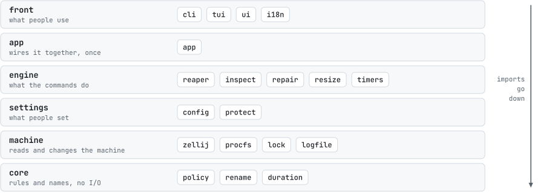
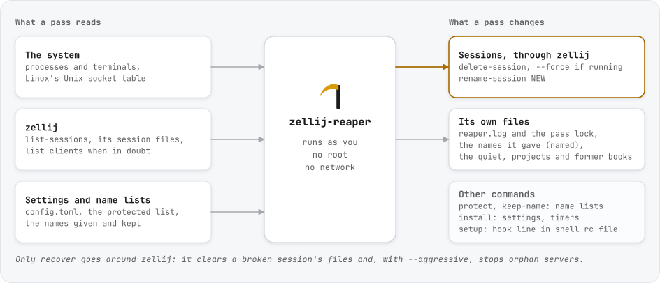
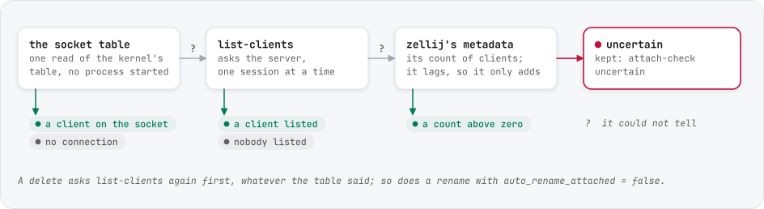
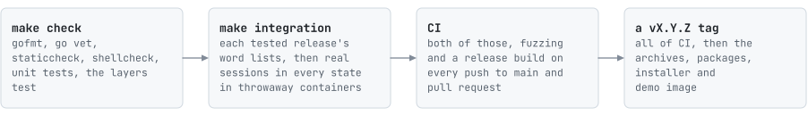

# zellij-reaper internals

How the code is laid out, how it reads the machine, why it reads what it reads, and how it is tested. For what a pass
does from the outside, see [how it decides](how-it-decides.md).

## Layout

The packages sit in layers, and an import goes down the layers, never up. `internal/layers_test.go` fails on an import
that goes up, on I/O in the core layer, and on a folder that belongs to no layer. `internal/version` and
`internal/testutil` sit outside the layers: anyone may import them, and they import nothing of ours.

<picture>
  <source media="(prefers-color-scheme: dark)" srcset="assets/layers-dark.svg">
  
</picture>

| Package | Holds |
|:---|:---|
| `internal/core/policy` | `Decide(facts, thresholds, now)`: the rules; every rule is a row in a table test |
| `internal/core/rename` | names from what a session shows, within the socket path's byte budget |
| `internal/core/duration` | the durations of the settings and the log, `1d12h` |
| `internal/machine/procfs` | one read of `/proc`, and the kernel's Unix socket table over netlink (sock_diag) |
| `internal/machine/zellij` | zellij's command line (`list-sessions`, `list-clients`, `delete-session`, rename) and its session files |
| `internal/machine/lock`, `logfile` | the pass lock (`flock`), the decision log |
| `internal/settings/config`, `protect` | settings and XDG paths, the protected list |
| `internal/engine/inspect` | the facts for every listed session, from one snapshot |
| `internal/engine/reaper` | `Plan`, the survey alone, and `Run`, the pass that acts on it |
| `internal/engine/repair`, `resize` | `recover` and `resize` |
| `internal/engine/systemd` | the user timer, and moving the shell scripts over |
| `internal/app` | builds the pieces once from the settings |
| `internal/front/cli`, `tui` | the commands, the dashboard |
| `internal/front/ui`, `i18n` | colors, the session table and the words for verdicts, shared by both; English and Korean |
| `internal/version` | the version, commit and date the build stamps in |
| `internal/testutil` | fake machines for tests: a `/proc`, terminals with chosen times, real Unix sockets, session files |

## Reading the machine

A pass reads what it needs and changes a few of its own files; the only sessions it touches go through zellij's own
commands. `recover` alone goes around zellij, because it is for sessions zellij can no longer reach.

<picture>
  <source media="(prefers-color-scheme: dark)" srcset="assets/touches-dark.svg">
  
</picture>

`reaper.Plan` and `reaper.Run` share one survey: list the sessions, take one snapshot of `/proc` and one of the
socket table, read each session's files, tell who is attached, then decide. `policy.Decide`
returns the action, a code, the evidence, how long the session still has to wait, and the checks in the order they
ran, ending with the one that decided. The log, `plan --json` and the dashboard each put that one verdict into their
own words.

| Fact | Read from | Why there |
|:---|:---|:---|
| sessions, exited or not | `zellij list-sessions --no-formatting` | zellij's own list; a name is everything before ` [Created`, so names with spaces survive |
| server and socket | the socket file's inode in the socket table, then `/proc/*/fd` | finds renamed sessions ([below](#renamed-sessions)) |
| panes | the server's child processes that read a terminal | zellij forks one process per pane, and runs helpers like `ps` that read none |
| busy | a pane process that is not a shell at its prompt, or a shell with a child | [below](#busy-panes) |
| last use | the newest read or write time of the panes' terminals | [below](#last-use) |
| attached | the socket table, then `zellij action list-clients` | [below](#attached-clients) |
| protected program | every process under the server, and the commands of the saved layout | an agent runs as `claude`, `node .../claude-code/cli.js`, or a script |
| exited time | the newest modification time in the session's `session_info` directory | frozen when the server ended |

## Decisions

### Fail closed

Every check keeps the session when its fact is missing or uncertain: no session directory, no socket, no server, an
attach check that failed, no pane processes. The rules delete only when every check passed on a fact that could be read.

### Last use

The time of last use is the newest read or write time of the panes' terminals, which the kernel moves on input and output
only. zellij's session files are a poor clock for a running session: zellij rewrites `session-metadata.kdl` about
once a minute whatever happens, which once made every session look used "0h" ago. They are the clock for exited
sessions, whose files stop changing when the server ends.

### Attached clients

<picture>
  <source media="(prefers-color-scheme: dark)" srcset="assets/clients-dark.svg">
  
</picture>

A client holds a connection to its server's socket, and the kernel's socket table shows it: the server's end carries the
listening socket's name and file, which the socket pairs a server keeps for itself do not, and the other end is open. On
zellij 0.43.1, 0.44.2, 0.44.3 and 0.45.1, with zero, one and two clients and on renamed sessions, counting those gives
the same number as `list-clients`.

The table comes first because it is one read for the whole pass and needs no process per session. Asking every server
was slower everywhere and unreliable on one release: zellij 0.44.2 answers `list-clients` calls that overlap with
nothing at all after a second, exit status 0, even when they go to different servers. `plan --json` over ten sessions,
300 times per release in the integration container:

| zellij | Asking every server, four at a time | The socket table first |
|:---:|---:|---:|
| 0.43.1 | 100 ms | 24 ms |
| 0.44.2 | 1125 ms, up to 5 s; 19% of verdicts `attach-unknown` | 26 ms |
| 0.44.3 | 123 ms | 27 ms |
| 0.45.1 | 104 ms | 26 ms |

`list-clients` stays for what the table cannot tell (no `unix_diag`, a client in another network namespace, whose
connection only that namespace lists, so the server holds a socket this table does not show; a connection whose other end
nobody can see), one session at a time, and for the second look before a delete or a rename: it asks the server
about this very moment. An answer with nothing in it is asked again, and so is one naming a client, because zellij 0.43
names the client that created a background session the first time it is asked, and a real client is still there the
second time.

Asking also changes something on 0.43.1: a background session asked early never saves its layout, so it would not show
as exited after a crash. That is one more reason for a pass to ask only what the table cannot tell.

The count in `session-metadata.kdl` lags: in the integration containers, a session made with `attach --create-background`
still had `connected_clients 1` ten seconds later on 0.45.1, and on 0.43.1 kept it until something else happened in the
session. It can only add a client, when the server does not answer. Browser clients are counted from the file as well,
so a session open in a browser is never taken for an idle one.

### Renamed sessions

When a session is renamed, zellij renames its socket file but keeps the server's command line (`--server
<first-name>`), and the kernel keeps the path the socket was bound to. Matching servers by command line, as the
shell scripts did, loses every renamed session: six months of the author's shell-version log hold 929
`server PID not found` verdicts on sessions it had renamed itself, none of which could ever be deleted.

The socket file's inode follows the rename. sock_diag (what `ss -x` reads) reports for each listening socket the inode
of its file (`UNIX_DIAG_VFS`), and `/proc/<pid>/fd` shows which process holds the socket. `internal/machine/procfs` asks
the kernel over netlink, so `ss` is not needed. The device number in `UNIX_DIAG_VFS` uses the kernel's own encoding
(`major << 20 | minor`), not the one `stat(2)` returns. Without `unix_diag` the command line is the fallback and
renamed sessions are kept as `no-server`.

The same matching lets `recover` tell a real orphan (a server whose socket file is gone) from a renamed session. The
shell version's `recover --aggressive` took every server whose first name had no file for an orphan, which includes
every renamed session. An orphan is still stopped only when no client is connected to it, no pane is busy, and
neither a protected program nor a protected name keeps it.

### Busy panes

A pane is idle when its process is a known shell by both its kernel name and its executable, started without a
script, with no child process. The shell scripts checked only for children, so a pane that runs a program directly
(`zellij run -- htop`, a command pane from a layout, where the program is the pane's process) looked idle. A script
started from its shebang has the script's name as its kernel name, so it is not taken for a shell either.

Not every child of a server is a pane. zellij runs `ps -ao ppid,args` to save its layouts, and plugins run commands of
their own; caught in the few milliseconds they live, those made an idle session look busy for that pass (a few verdicts
in every thousand with layouts saved once a second). A helper has no controlling terminal, because the server has none to
pass on, and every pane has one, whatever its input was pointed at afterwards: `nohup sleep 9` and `exec sleep 9
</dev/null` in a command pane are real jobs and stay panes. So a child with no controlling terminal and no terminal for
input is left out.

### zellij's directories

zellij 0.44 moved its socket and data directories from a version-named one (`0.43.1`) to `contract_version_1`. The
version from `zellij --version` picks the directory, taking the highest `contract_version_N` present for later
releases. Running servers name their socket on their command line, so the socket directory is taken from them
whenever one runs.

### Names

A name someone chose stays, and zellij leaves a way to tell: a server's command line keeps the name its session started
under through every rename. A session that still has that name was never renamed, so the only name to replace is one
zellij made up. zellij's own word lists tell such a name, since `web-app` has the same shape as `brave-peach`. A session
with another name was renamed, by a pass or by someone. A pass writes the names it gives in the list of given names, so
it can follow what the session shows next. The shell version and releases before 0.2.0 wrote no list but stamped every
name with the time of last use (`_1104-0931`), so that stamp tells their names. It has to be a real date and time:
`report_2025-2026` has its shape, and there is no month 20. Before 0.3.0, the only way to keep a name was the protected
list, which keeps the session from being reaped as well. Without it, the demo's `agent-refactor` became `claude`.

The list holds names, not sessions, and an entry can outlive its session for up to one pass. The command line is what
keeps that from costing anyone a name: a session someone starts under a name on the list still has the name it started
under. The decision log is no help here. It says which name a pass gave, not to which session, and zellij gives a name
out again once its session is gone; 0.3.2 read it, and replaced names people chose.

zellij keeps nothing that tells a name it made up from the same words typed by a person: a session started either way,
in a terminal or in the background, has the same server command line, environment and files. So a person keeps such a
name once for each session: `r`, Tab and Enter in the dashboard. The name goes on
the list of kept names, which every pass reads first. A pass that cannot read that list renames nothing.

A name has to stay put to be useful, so it changes only when what the session shows changes. The shell version added the
time of last use to every name, which renamed a session in use on every pass: 20,536 of the 20,839 renames in its author's
log moved nothing but the time. `auto_rename_stamp` brings the stamp back for those who want it, by the day or the minute.

A pass renames sessions someone is attached to as well: on a machine whose sessions stay attached, renaming only the
others left nothing to rename. The person in such a session sees its name change, and its panes keep the old name in
`ZELLIJ_SESSION_NAME`, so a `zellij` command run there without `--session` waits for a session by that name.
`auto_rename_attached = false` renames only the sessions nobody is attached to.

`rename.Suggest` looks at the focused pane first, then at the other panes that are still running. Once nobody is
attached zellij marks no tab active, so a pass starts from the first tab's focused pane. A title with something to say
becomes the name once the terminal noise is out of it: spinners and emoji, a command line's flags, the directories of
its paths, a URL's scheme, an ssh target's user. A shell's own title gives its directory, or the machine when it is
another one. A title that only names the program (`Claude Code` before its first task, `nvim`) goes after the directory
the first pane works in now, read from `/proc`, which follows a `cd` where the session's layout does not. A session with
no title to go by takes the program and the plain words after it, stopping at the first flag: a command line is not on
the screen the way a title is, and its arguments can hold a password. A metadata file caught while zellij rewrites it
gives no name at all. A name holds only English letters, digits, `-`, `_` and `.`: a word in another writing system, or
with an accent, is left out whole. Names stop at 32 characters, at the end of a word.

Two sessions showing one title get a `-2` tail, which then stays: the shell version compared names without it and swapped
such sessions between `-2` and `-3` on every pass. zellij also refuses a name a session has had before, which is another
way to end up with a tail.

zellij does not protect a name that is taken. Since 0.44, `rename-session` exits 0 and moves the session's socket file
over the other session's, which leaves that other server running with no way to reach it. `zellij.CLI.Rename` looks at
the list first and refuses, then waits until zellij lists the new name before calling the rename done. A pass and the
dashboard also refuse a name whose socket file is already there, listed or not: zellij has left a session out of its
list for a moment right after renaming it. When zellij took the request and the new name does not show in time, the
dashboard keeps both names on the protected list, since the session may have either.

### Names and the socket path

A session's name is part of its socket path, and Linux caps a socket path at 107 bytes. Early shell versions cut names
at 50 characters, which is 150 bytes for a title of three-byte characters; renamed past the limit, a session kept a
server no command could reach. Names are now cut by bytes, at a character boundary, to what the session's own socket
directory leaves, with room for a stamp and a collision suffix. `recover` repairs sessions broken the old way.

### The log

People grep months of the log, so its words stay. The verdict texts (`REAP IDLE`, `SKIP client attached`,
...) and the `=== reaper start/end ===` lines stay fixed; new kinds of lines may be added. The log rotates by
renaming at the start of a pass, under the lock, so a pass is never split across the two files, and a rename that
fails is written into the log instead of stopping the pass.

### One lock, and a second look

The timer, `zellij-reaper run`, `recover` and the dashboard's actions take the same `flock`; a pass that cannot get it
within five seconds (two for a dashboard action) leaves the work to the one that holds it. A pass gathers every fact
first and then acts one session at a time, and each delete can take a moment, so it asks again just before each
delete and, with `auto_rename_attached = false`, each rename. The dashboard asks too before a delete by hand. Someone
who attached in between keeps the session.

### The dashboard

The model holds the last plan and draws from it; every five seconds it asks its `Backend` for a new one. All I/O sits
behind `tui.Backend`, so the tests drive the real model with a fake backend.

## Tests

A change comes with a test that fails without it. A bug report becomes a test first: a row in the policy table, a fake
machine in `inspect` or `reaper`, a dashboard state, or an integration scenario.

| Level | Where | What it shows |
|:---|:---|:---|
| Layers | `internal/layers_test.go` | no import goes up a layer, no I/O in the core layer, no folder outside the layers |
| Rules | `internal/core/policy` | every code, the order, the waits at their boundary, force, clock skew |
| Names | `internal/core/rename` | every kind of title, what says nothing, words in other writing systems, cuts at a word and by bytes, stamps, collision tails |
| Parsers | `internal/machine/zellij`, `internal/machine/logfile`, `internal/settings/config` | `list-sessions`, `list-clients`, metadata and layout files recorded from zellij 0.44.2 and 0.45.1 (`testdata/`), KDL strings, log lines, settings and their errors |
| The kernel | `internal/machine/procfs` | `/proc` parsing on a fake tree, sock_diag against a real socket |
| Facts | `internal/engine/inspect` | each kind of pane, a server's helpers, protected programs, the three sources of clients, renamed and exited sessions, on fake machines |
| Passes | `internal/engine/reaper` | what is deleted and renamed, dry runs, force, the protected list, the lock, the log's exact lines |
| Setup | `internal/engine/systemd` | unit files, a fresh install, moving the shell scripts over, the timer's status, uninstall |
| Dashboard | `internal/front/tui` | every state at five sizes in English and Korean, each frame exactly the terminal's size; every action |
| Real zellij | `test/integration` | every scenario on real sessions in every state, on each [tested release](setup.md#zellij-versions), in throwaway containers |

```sh
make check                               # gofmt, go vet, staticcheck, shellcheck, go test -race ./...
make integration                         # each tested zellij release in Docker; the sessions run with no network
make integration ZELLIJ_VERSIONS=0.45.1  # one release
make demo                                # the dashboard on demo sessions in a container, to try by hand
```

The integration scenarios make sessions in a container:

- idle sessions, with their terminals' times moved back
- busy ones: a shell running a command, a command pane, a stand-in coding agent
- a client attached through `script(1)`
- exited sessions, their server killed after zellij saved the layout
- a renamed one, a protected one, and two showing the same title
- titles to name: a long one, one with words in other writing systems, one that gives a name with a dot in it
- names: one zellij made up, and names people chose by starting a session or by renaming one, some of them two words
  from zellij's lists or in the shape of a stamp

Then they check `plan`, a dry run, a pass, a forced pass, `auto_rename`, `recover` and the other commands against what
zellij lists afterwards. A check that fails prints the plan, what zellij listed and the last pass in the log, so a rare
failure leaves its evidence in the test output.

<picture>
  <source media="(prefers-color-scheme: dark)" srcset="assets/release-dark.svg">
  
</picture>

**CI** (`.github/workflows/ci.yml`) runs `make check`, the integration scenarios once per zellij release, and a snapshot
release build on every push to `main` and every pull request. A new zellij release joins the matrix, and
`default_versions` in `test/integration/run.sh`, once it passes.

**A release** is a `vX.Y.Z` tag with a `## [X.Y.Z]` section in `CHANGELOG.md`. `.github/workflows/release.yml` runs
all of CI on the tagged commit. Then GoReleaser builds the archives, `checksums.txt` and the packages from
`.github/goreleaser.yaml` and attaches `scripts/install.sh`, with the changelog section as the release notes, and the
demo image goes to ghcr.io for amd64 and arm64.

**Not covered:** systemd itself (the containers run zellij-reaper directly, not from the timer; the unit files and
the install steps are tested against a stand-in `systemctl`), distributions other than the Debian-based test image,
WSL 2, how terminal emulators draw the dashboard, and zellij releases outside the matrix.
