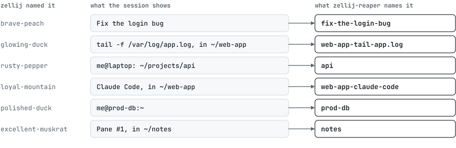

# Setting up zellij-reaper

1. [Requirements](#requirements)
2. [Install](#install)
3. [Coming from the shell scripts](#coming-from-the-shell-scripts)
4. [Without internet access](#without-internet-access)
5. [Upgrade and uninstall](#upgrade-and-uninstall)
6. [Settings](#settings)
7. [Protecting sessions](#protecting-sessions)
8. [Naming sessions after what they show](#naming-sessions-after-what-they-show)
9. [Files](#files)
10. [zellij versions](#zellij-versions)
11. [macOS](#macos)
12. [Windows](#windows)
13. [WSL 2](#wsl-2)

## Requirements

| | Needs | Best with |
|:---|:---|:---|
| System | Linux on x86_64 (amd64) or arm64, or WSL 2 with [systemd turned on](#wsl-2); [macOS](#macos) on Apple silicon or Intel; [Windows](#windows) on x64 | on Linux, a kernel with `unix_diag` (all common distributions), so clients and renamed sessions are found without asking zellij |
| zellij | 0.43 to 0.45 ([what differs](#zellij-versions)), 0.44 to 0.45 on Windows | 0.45.1 |
| Timers | Linux: a systemd user instance, or [cron](#without-systemd); macOS: launchd; Windows: the Task Scheduler | systemd with lingering, which `install` turns on |
| Dashboard | a terminal of 30 by 8 cells, and a font with `●`, `✓`, `✗` and `→` | 100 columns and 256 colors; from 132 columns the details sit beside the list |
| Prompt hook | bash, zsh or fish, on Linux and macOS | |
| Install script | `curl`, `tar`, and `sha256sum` or `shasum`; on Windows, PowerShell 5.1 or later | |
| Demo sandbox | Docker | |

The binary is 7.5 MB and needs no other library. A pass takes about 26 ms and 12 MB with 13 sessions and 113 ms and
13 MB with 100 ([measured](../README.md#why-zellij-reaper)), and nothing stays running between passes. The dashboard, while it is open, uses about 16 MB and
reads the sessions every five seconds.

## Install

The [Quick start](../README.md#quick-start) covers the usual install. Without systemd, the passes run from
[cron](#without-systemd).

```sh
curl -fsSL https://github.com/kanggu12/zellij-reaper/releases/latest/download/install.sh | sh
```

The script works on Linux and macOS. It downloads the latest release for your system and architecture,
checks it against the release's `checksums.txt` and installs it to `~/.local/bin`. On a first install in a terminal it
then opens [the setup screen](commands.md#setting-up); <kbd>esc</kbd> there keeps the defaults. Otherwise (an upgrade,
or no terminal) it runs `zellij-reaper install`. On
Windows, `install.ps1` does the same in PowerShell, puts the binary in `%LOCALAPPDATA%\Programs\zellij-reaper` and adds
that folder to your `PATH`:

```powershell
irm https://github.com/kanggu12/zellij-reaper/releases/latest/download/install.ps1 | iex
```

These variables change what it does, set on `sh` (`curl -fsSL URL | ZELLIJ_REAPER_BIN_DIR=~/bin sh`):

| Variable | Default | Effect |
|:---|:---:|:---|
| `ZELLIJ_REAPER_VERSION` | the latest release | install a given release, like `v0.3.0` |
| `ZELLIJ_REAPER_BIN_DIR` | `~/.local/bin` | where the binary goes |
| `ZELLIJ_REAPER_NO_TIMER` | | `1` installs the binary only |
| `ZELLIJ_REAPER_NO_SETUP` | | `1` starts the timers with the defaults, without the setup screen |
| `ZELLIJ_REAPER_BASE_URL` | GitHub releases | download from a mirror |

`install.ps1` takes the same variables from PowerShell (`$env:ZELLIJ_REAPER_NO_TIMER = '1'` before `irm ... | iex`);
its `ZELLIJ_REAPER_BIN_DIR` defaults to `%LOCALAPPDATA%\Programs\zellij-reaper`.

In a script, or over `ssh host command` with no terminal, make the setup screen's choices as flags: install the binary
alone, then let `setup` write them and start the timers ([the flags](commands.md#setting-up)):

```sh
curl -fsSL https://github.com/kanggu12/zellij-reaper/releases/latest/download/install.sh | ZELLIJ_REAPER_NO_TIMER=1 sh
~/.local/bin/zellij-reaper setup --idle-after 4h --exited-after 1w --dry-run
```

Other ways:

| From | Then |
|:---|:---|
| a package (`.deb`, `.rpm`, `.apk`, Arch) from the [releases page](https://github.com/kanggu12/zellij-reaper/releases) | the binary is in `/usr/bin`; each user who wants a timer runs `zellij-reaper install` |
| a release archive, `zellij-reaper_<version>_<os>_<arch>.tar.gz` (`.zip` for Windows) | put the binary on your `PATH`, run `zellij-reaper install`; on macOS, `xattr -d com.apple.quarantine zellij-reaper` first if a browser downloaded it |
| source: `go install github.com/kanggu12/zellij-reaper/cmd/zellij-reaper@latest` | `zellij-reaper install` |
| a clone: `make install` | builds, copies to `~/.local/bin` and installs the timer |

Every archive, package and installer of a release, from 0.13.0 on, comes with a signed record of the workflow run and
commit it was built from. `checksums.txt` shows a download is the file the release lists; the record shows the release's
files came from this repository's own build. With the [GitHub CLI](https://cli.github.com):

```sh
gh attestation verify zellij-reaper_0.13.0_linux_amd64.tar.gz --repo kanggu12/zellij-reaper
```

### What `zellij-reaper install` does

On Linux it:

- Writes `zellij-reaper.service` and `zellij-reaper.timer` to `~/.config/systemd/user/`. The service runs this binary
  (its absolute path at install time) with `run --quiet`, with zellij's directory first in its `PATH`.
- Writes and starts `zellij-reaper-names.service` and `zellij-reaper-names.timer`, which run `run --names-only --quiet`
  every `rename_interval` (5 minutes), the first time a minute after they start. With `rename_interval = "0"`, it
  removes them. A names pass does nothing while `auto_rename` is off.
- Writes `~/.config/zellij-reaper/config.toml` if there is none, every key commented out at its default.
- Enables the timer and turns on lingering (`loginctl enable-linger`), so the timer runs without a login.
- Without a systemd user instance, puts the two jobs in your crontab instead, when a cron daemon runs
  ([without systemd](#without-systemd)).
- Says when the first pass runs and how many sessions it would delete.

On macOS it writes two launch agents to `~/Library/LaunchAgents/`, `io.github.kanggu12.zellij-reaper.plist` and
`io.github.kanggu12.zellij-reaper-names.plist`, and loads them with `launchctl bootstrap`. launchd starts a job that
has an interval once the interval has passed, so the first pass comes one `interval` (an hour) after install.

On Windows it registers one task in the Task Scheduler, `zellij-reaper`, which starts the binary through
`conhost.exe --headless` so no window opens. The first pass comes ten minutes later. There is no names task, since
nothing is renamed on Windows.

Both write the settings file if there is none.

Run it again after moving the binary or changing `interval` or `rename_interval`. It never overwrites a settings file.
With `--config FILE` (or `ZELLIJ_REAPER_CONFIG`), the timer is set up to read that file too.

### Without systemd

When no systemd user instance answers (WSL without systemd, many containers) and a cron daemon runs, `install` puts two
lines in your crontab, each ending in `# zellij-reaper`: a pass every `interval` and a names pass every
`rename_interval`, at the nearest step cron can repeat at (5 minutes, an hour, ...). cron has no start delay, so the
first pass comes the next time its line comes round (five past the hour, by default), not ten minutes after install;
the setup screen and `install` give that time. cron reads the lines on the system's clock (`/etc/localtime`); with
another `TZ` in your shell, the times shown are converted to it. Each line carries its own `PATH`,
with zellij's directory first, and your `XDG_RUNTIME_DIR`; your other lines are left as they are. `uninstall` removes
only those two, and once systemd answers, `install` moves the passes back to its timers. With neither, `install` stops
and says so: turn on systemd (on WSL, `systemd=true` in `/etc/wsl.conf`) or start cron (`sudo service cron start`).

To write the lines yourself instead, install with `ZELLIJ_REAPER_NO_TIMER=1`. cron starts a job with a short `PATH` and
none of the variables your login sets, so put what the job needs at the top of your crontab (`crontab -e`), with your
home directory in place of `/home/me`:

```
PATH=/home/me/.local/bin:/usr/local/bin:/usr/bin:/bin
XDG_RUNTIME_DIR=/run/user/1000
5 * * * * zellij-reaper run --quiet
*/5 * * * * zellij-reaper run --names-only --quiet
```

The third line runs a pass at five past every hour, and the last one renames every five minutes; written by hand,
`interval` does not change them. `PATH` has to find both `zellij-reaper` and `zellij`: without `zellij` on it, a pass logs
`zellij not installed, nothing to do` and exits 0. `XDG_RUNTIME_DIR` is where zellij keeps its sockets. Copy the value
`echo "$XDG_RUNTIME_DIR"` prints in your shell, or leave the line out if it prints nothing. With any other value, a pass
does not see your running sessions.

## Coming from the shell scripts

The earlier version was two shell scripts, `~/.local/bin/zellij-reaper.sh` and `~/.local/bin/zellij-reap`, set up
with `Environment=` lines in the same service file. `zellij-reaper install` finds them and moves them over:

| The shell version | Becomes |
|:---|:---|
| `DRY_RUN` (its default: on) | `dry_run` |
| `MAX_AGE_HOURS` or `MAX_AGE_DAYS` (its default: 3 days) | `idle_after` and `exited_after` |
| `PROTECT_REGEX` | `protect` |
| `AUTO_RENAME` (its default: on) | `auto_rename` |
| `LOG_MAX_BYTES` | `log.max_bytes` |
| `LOG` | `log.path` |
| `~/.cache/zellij-reaper.log` and `.log.1` | moved to `~/.local/state/zellij-reaper/reaper.log` and `.1` |
| the two scripts and `~/.cache/zellij-reaper.lock` | removed |

The settings file is written only when there is none; if one exists, `install` keeps it and says the shell version's
settings were not moved. The scripts are removed only when they are recognizably the shell version's. The shell
version ran as a dry run unless its service set `DRY_RUN=0`, and the moved-over settings keep that: check `dry_run`
with `zellij-reaper config show`.

## Without internet access

zellij-reaper needs no network to run: it makes no connection, and its integration tests run in a container with none.
Only the install script downloads anything, so on a closed network, skip it. On a machine with internet access, fetch the
archive for the target's architecture (`amd64` or `arm64`) and the checksums, and carry both across:

```sh
base=https://github.com/kanggu12/zellij-reaper/releases/latest/download
version=$(curl -fsSLI -o /dev/null -w '%{url_effective}' \
  https://github.com/kanggu12/zellij-reaper/releases/latest | sed 's|.*/v||')
curl -fsSLO "$base/zellij-reaper_${version}_linux_amd64.tar.gz"
curl -fsSLO "$base/checksums.txt"
```

Then, on the closed machine, set `version` to the release you carried across and run:

```sh
version=0.7.0
grep " zellij-reaper_${version}_linux_amd64.tar.gz\$" checksums.txt | sha256sum -c - &&
  tar -xzf "zellij-reaper_${version}_linux_amd64.tar.gz" zellij-reaper &&
  install -Dm0755 zellij-reaper ~/.local/bin/zellij-reaper &&
  ~/.local/bin/zellij-reaper install
```

`sha256sum -c` prints `OK` for a good file. A damaged file makes it fail, and `&&` stops the lines after it. With no
systemd on that machine, `install` says so; [run the passes from cron](#without-systemd) instead. The other ways work
offline too:

- **A package:** copy the `.deb`, `.rpm`, `.apk` or `.pkg.tar.zst` instead of the archive, and install it with `dpkg -i`,
  `rpm -U`, `apk add --allow-untrusted` or `pacman -U`. Then each user who wants the timer runs `zellij-reaper install`.
- **Many machines:** put the release's files on an internal web server as `<base>/v<version>/<file>`, and the install
  script works from there: `ZELLIJ_REAPER_BASE_URL=<base> ZELLIJ_REAPER_VERSION=v<version> sh install.sh`. It needs the
  version, since only GitHub can say which release is the latest.
- **zellij itself:** one binary too, from [its releases](https://github.com/zellij-org/zellij/releases):
  `zellij-<machine>-unknown-linux-musl.tar.gz`.
- **The demo image:** on a machine with internet access, `docker pull ghcr.io/kanggu12/zellij-reaper-demo`, then
  `docker save ghcr.io/kanggu12/zellij-reaper-demo | gzip >demo.tar.gz`. On the closed machine, `docker load
  <demo.tar.gz`. It runs with `--network none`.
- **From source:** with Go 1.26.10 or newer on the closed machine, run `go mod vendor` in a clone on a machine with internet
  access and carry the whole clone across. Then run `GOFLAGS=-mod=vendor GOTOOLCHAIN=local make build`; the binary is
  `dist/zellij-reaper`.

A closed network also keeps you from checking for new releases: the steps above are how to upgrade as well.

## Upgrade and uninstall

**Upgrade** by running the install script again, or with your package manager. The settings stay, and the script runs
`zellij-reaper install`, which rewrites the timers; the setup screen opens only on a first install
(`zellij-reaper setup` opens it any time). After moving the binary by hand, run `zellij-reaper install` again:
`doctor` notices a timer that still runs an old path. On Windows, a copy that is running while `install.ps1` upgrades it
(the dashboard, or the task at that moment) is renamed to `zellij-reaper.exe.<time>.old` and runs on; the next install
removes it. When the task cannot be registered, `install.ps1` ends with an error that says so, with the new binary in
place.

**Uninstall** in two steps: first what the program set up, then the program.

```sh
zellij-reaper uninstall          # the timers; the settings, the log and the lists stay
zellij-reaper uninstall --purge  # those too, and the prompt hook
```

`uninstall` stops and removes the timers: on Linux both the systemd units and the reaper's lines in your crontab, not
only the one that runs the passes today; on macOS the launch agents; on Windows the scheduled task. It lists what it removed,
and run again it says there was nothing left. It does not need the settings file to load, so a file that no longer
parses does not keep the timers on.

`--purge` also removes the settings, the log, the protected list and the lists of given and kept names, and takes the
prompt hook out of `~/.bashrc`, `~/.zshrc` and `~/.config/fish/config.fish`: the line `setup` added, where it still reads
as `setup` wrote it. The startup file is changed in place, so one that is a link into your dotfiles stays a link. What
a purge leaves, it names: a hook line written another way, a file of yours in one of its folders, a file it could not
remove.

Neither removes the program, and the last line of a purge says where it is:

| Installed with | Remove it with |
|:---|:---|
| the install script | `rm ~/.local/bin/zellij-reaper` |
| a package | `sudo apt remove zellij-reaper`, `sudo dnf remove zellij-reaper`, `sudo apk del zellij-reaper` or `sudo pacman -R zellij-reaper` |
| `go install` | `rm "$(go env GOPATH)/bin/zellij-reaper"` |
| `install.ps1` | delete the folder `%LOCALAPPDATA%\Programs\zellij-reaper` and take it out of your user `PATH` |

Run `uninstall` before removing the program: without it the timer stays and fails at every pass. Under a package, each
user who ran `install` runs `uninstall`. Lingering stays on, since other services of yours may rely on it;
`loginctl disable-linger` turns it off.

**Repair** an install by running `zellij-reaper install` again: it rewrites the timers and keeps the settings, the log
and the lists. `zellij-reaper doctor` says what is wrong first. With a settings file that no longer parses, a command
that needs the settings stops and names the file and the line; `zellij-reaper config edit` opens it and checks what
you saved, and moving the file away starts again from the defaults.

## Settings

The file is `~/.config/zellij-reaper/config.toml` (`$XDG_CONFIG_HOME/zellij-reaper/config.toml`, or the file named by
`ZELLIJ_REAPER_CONFIG` or `--config`). Every key is optional. Durations take `s`, `m`, `h`, `d` and `w`, combined as
in `1d12h`; `"0"` means no wait.

| Key | Default | Meaning |
|:---|:---:|:---|
| `dry_run` | `false` | log decisions, delete and rename nothing |
| `idle_after` | `"12h"` | how long a running session must be idle |
| `exited_after` | `"3d"` | how long an exited session is kept for resurrection |
| `protect` | `""` | a regular expression ([Go syntax](https://pkg.go.dev/regexp/syntax)); matching names are never reaped or renamed |
| `protect_commands` | `["claude", "codex", "gemini", "aider", "opencode"]` | programs that keep a running session |
| `shells` | `[]` | extra programs that count as a prompt |
| `auto_rename` | `false` | name the sessions nobody named after what they show |
| `auto_rename_attached` | `true` | rename sessions with a client attached too; `false` waits until nobody is attached |
| `auto_rename_stamp` | `"none"` | what those names end in: `"none"`, `"date"` or `"time"` |
| `auto_rename_drop_tail` | `false` | give a session back the name without its `-2` once nobody else has it |
| `interval` | `"1h"` | how often the timer runs, up to five minutes late; at least `1m`; run `install` again after changing it |
| `rename_interval` | `"5m"` | how often the names timer renames; `"0"` turns it off; run `install` again after changing it |
| `zellij` | `""` | the zellij binary; empty means the first one in `PATH` |
| `log.path` | `~/.local/state/zellij-reaper/reaper.log` | the decision log |
| `log.max_bytes` | `1048576` | the size at which the log moves to `.1`; `0` never |

Most keys also take a variable: `ZELLIJ_REAPER_` and the key in capitals (`ZELLIJ_REAPER_IDLE_AFTER`), except
`ZELLIJ_REAPER_LOG` for `log.path` and `ZELLIJ_REAPER_LOG_MAX_BYTES` for `log.max_bytes`. `protect_commands`, `shells`,
`interval` and `rename_interval` are set in the file only.

A variable wins over the file, and `run --dry-run` and `run --force` win over both. Variables set in your shell apply
to the commands you run there, not to the timer: `install` and `doctor` warn about each one, so put lasting settings
in the file. A value that cannot be read (a duration without a unit, a pattern that does not compile) stops the
command with an error instead of falling back to a default, and so does a key nothing reads: a typo in `protect` must not
leave a session unprotected. In a file with a `[log]` table, as earlier versions wrote it, add new keys above that table.

`zellij-reaper config show` prints each setting and where its value comes from:

```
# ~/.config/zellij-reaper/config.toml
dry_run              = false                                               # default
idle_after           = "4h"                                                # file
exited_after         = "1d"                                                # file
protect              = ""                                                  # default
protect_commands     = ["claude", "codex", "gemini", "aider", "opencode"]  # default
...
```

## Protecting sessions

There are three ways to protect a session:

- **A name pattern** in the settings: `protect = "^(keep-|work-)"`.
- **One session at a time:** `zellij-reaper protect NAME`, or `p` in the dashboard. `protect` with no name lists them;
  `unprotect NAME` removes one. A session renamed from the dashboard keeps its place on the list.
- **A running program:** while a program from `protect_commands` runs anywhere in a running session, or its layout
  starts one, the session is kept, even when the pane running it looks idle.

The first two also stop renaming. A session kept only for a running program can still be renamed if nobody chose its
name; with `auto_rename_attached = false`, only while no client is attached.

## Naming sessions after what they show

With `auto_rename = true`, every pass names the sessions it keeps after what they show, unless someone chose their
name. On Windows nothing is renamed ([why](#windows)). zellij keeps the name a session started under on its server's
command line, and that is how a pass tells who chose a name:

- **A session that still has that name** was never renamed. A pass replaces its name only if it is two words from
  zellij's own lists (`brave-peach`).
- **A session renamed since** keeps its name unless a pass gave it. Passes write the names they give in the list of
  given names. The shell version and 0.1 releases stamped theirs instead (`web-app_1104-0931`), and those go too, unless
  `auto_rename_stamp = "time"`. 0.2.0 did neither by default, so a name 0.2.0 gave stays until someone changes it.

A session that is exited, protected by name or uncertain keeps its name. With `auto_rename_attached = false`, so does
one with a client attached.

**To keep a name as it is,** whoever gave it, select a running session in the dashboard and press `r`, then Tab, then
Enter. The field starts with the suggested name, and Tab puts back the name the session has; the keys under the field
say what Enter will do. Do it once for each session; passes leave that name alone from then on.

This is also how to keep a name you typed in zellij's own words (`zellij -s quiet-mouse`): nothing zellij keeps tells it
from a name zellij made up, since the command line, environment and files are the same. `r` renames a session by hand
too, with `auto_rename` on or off.

<picture>
  <source media="(prefers-color-scheme: dark)" srcset="assets/names-dark.svg">
  
</picture>

The name comes from the first of these that says something:

1. **A pane's title**, the focused pane first, then the other panes still running. With nobody attached zellij marks no
   tab active, so that is the first tab's focused pane.
2. **The directory and the program**, when the titles only name a program (`Claude Code`, `nvim`) or say nothing:
   `web-app-claude-code`, `api-npm-run-dev`. The directory is where the first pane works now, so it follows a `cd`. From
   a command line it takes only the plain words up to the first flag, since arguments can hold a password.
3. **The directory alone**, for a shell with nothing running.

Your home directory and `/` say nothing, so a shell at home with a title like `Pane #1` keeps its name.

These parts of a title are dropped or shortened:

| In the title | Becomes | Example |
|:---|:---|:---|
| Spinners, stars, emoji | nothing | `✳ Fix the login bug` is `fix-the-login-bug` |
| A command's flags | nothing | `docker compose up -d --build` is `docker-compose-up` |
| A path | its last part | `vim ~/notes/today.md` is `vim-today.md` |
| A URL | no scheme, no password | `https://github.com/foo/bar` is `github.com-foo-bar` |
| An ssh target | no user | `ssh me@prod-db` is `ssh-prod-db` |
| A shell's own title | its directory, and the machine if it is another one | `me@laptop: ~/api` is `api`, `me@buildbox:/srv/app$` is `buildbox-app` |
| `Pane #1`, `Tab #2`, a bare `bash` | nothing | |

These rows show the title alone. A title that repeats what the pane runs falls under rule 2: `tail -f /var/log/app.log`
run in `~/web-app` gives `web-app-tail-app.log`.

Names hold only English letters, digits, `-`, `_` and `.`, so they type on any keyboard and need no quotes in a shell.
A word in another script, or with an accent, is left out whole: `Déploiement prod` gives `prod`. A title with nothing
left says nothing, like `Pane #1`. A `.` stays inside a word, so `notes.md` still reads as a file. Names stop at 32
characters, at the end of a word, and within what the session's socket path leaves of Linux's 107-byte limit.

A name changes only when what the session shows changes, so a script that attaches by name keeps working until then.
When a name is taken, the session gets a `-2`, `-3`, and keeps that tail. zellij refuses a name a session has had before,
so a title that comes back gives a tail too.

Each pane keeps the session name it was opened under, in `ZELLIJ_SESSION_NAME`. After a rename, a `zellij` command run
in an older pane without `--session`, such as `zellij run` or a prompt that runs `zellij action rename-tab`, waits for a
session by the old name while any other session is running. Panes opened after the rename have the new name. The
prompt hook keeps every pane current: at each prompt it sets `ZELLIJ_SESSION_NAME` to what `zellij-reaper here` prints,
the name the pane's session has now, read from the process table and zellij's socket files in about a millisecond,
with no zellij process. Add it to the shell's startup file:

```sh
command -v zellij-reaper >/dev/null && eval "$(zellij-reaper shell-hook bash)"     # ~/.bashrc
command -v zellij-reaper >/dev/null && eval "$(zellij-reaper shell-hook zsh)"      # ~/.zshrc
type -q zellij-reaper; and zellij-reaper shell-hook fish | source                  # ~/.config/fish/config.fish
```

In a shell started before you added the hook, run `export ZELLIJ_SESSION_NAME=$(zellij-reaper here)` once. The test
before each hook keeps a shell quiet where `zellij-reaper` is not on its `PATH`: a login shell that adds `~/.local/bin`
only after the startup file runs, or a machine it was removed from. `setup` up to 0.10 wrote fish's line without it;
`uninstall --purge` takes out that line too.

The names timer runs a renaming pass every `rename_interval` (5 minutes). It deletes nothing but the copy zellij may
leave of a renamed session under its old name, and writes to the log only when it renames. The hourly pass renames too.
`zellij-reaper keep-name NAME` keeps a name as `r`, Tab and Enter do; `forget-name NAME` lets passes rename it again,
and `keep-name` alone lists the kept names. With `auto_rename_drop_tail = true`, the hourly pass gives a session it
named `api-2` the name `api` once no other session has it; zellij refuses a name the session had before, and then the
tail stays.

`auto_rename_stamp` adds when a session was last used, in local time: `"date"` gives `web-app_1104`, which renames a
session you keep using once more a day, and `"time"` gives `web-app_1104-0931`, which renames it on every pass.

## Files

<picture>
  <source media="(prefers-color-scheme: dark)" srcset="assets/files-dark.svg">
  
</picture>

| Path | What |
|:---|:---|
| `~/.config/zellij-reaper/config.toml` | the settings |
| `~/.config/systemd/user/zellij-reaper.{service,timer}` | the timer, written by `install` |
| `~/.config/systemd/user/zellij-reaper-names.{service,timer}` | the names timer, written by `install` |
| `~/.local/state/zellij-reaper/reaper.log` and `.1` | the decision log |
| `~/.local/state/zellij-reaper/protected` | the protected list, one name per line |
| `~/.local/state/zellij-reaper/protected.lock` | held while the protected list is changed |
| `~/.local/state/zellij-reaper/named`, `named.lock` | the list of given names: names a pass gave, so it can tell them from a name someone chose |
| `~/.local/state/zellij-reaper/kept`, `kept.lock` | the list of kept names: names kept with the dashboard or `keep-name`, which no pass renames |
| `~/.local/state/zellij-reaper/quiet` | when a pass first found each session quiet, for sessions whose terminals cannot be read (every session on Windows) |
| `~/.local/state/zellij-reaper/lock` | the pass lock |

`$XDG_CONFIG_HOME` and `$XDG_STATE_HOME` move them. On macOS the same paths apply, and the timers are the launch agents
in `~/Library/LaunchAgents/`. On Windows the settings are in `%APPDATA%\zellij-reaper\` and the rest of these files in
`%LOCALAPPDATA%\zellij-reaper\`, and the timer is a scheduled task.

zellij-reaper reads zellij's files and never writes there, except `recover` clearing a broken session: under
`$XDG_CACHE_HOME/zellij` (`~/.cache/zellij`) on Linux, `~/Library/Caches/org.Zellij-Contributors.Zellij` on macOS and
`%LOCALAPPDATA%\Zellij\cache` on Windows.

## zellij versions

CI runs real sessions on zellij 0.43.1, 0.44.3 and 0.45.1 on Linux, and on 0.45.1 on macOS and Windows. The
differences it handles:

| | 0.43 | 0.44, 0.45 |
|:---|:---|:---|
| Data and socket directories | named after the version: `~/.cache/zellij/0.43.1/` | `contract_version_1` |
| A session made with `attach --create-background` | the first `list-clients` names the client that made it, so it is asked twice | counts none |
| The client count in the metadata file | can keep counting that client until something happens | rewritten about once a minute |
| Renaming to a name that is taken | refused | accepted, cutting the other session off, so zellij-reaper looks first |

zellij 0.44 and 0.45 also stop a session that is starting when another program connects to it and leaves within
about a tenth of a second ([zellij issue 5632](https://github.com/zellij-org/zellij/issues/5632)), and
`list-sessions` connects to every session. Before it lists the sessions, zellij-reaper waits until every server is a
second old, so a pass or the dashboard never stops a session you are opening.

zellij 0.44.2 prints nothing when `list-clients` calls overlap, so zellij-reaper does not overlap them. The version comes
from `zellij --version`. Older releases may work; they are not tested.

zellij's main branch, its next release, names a session's socket and its folder under `session_info` by a short id that
stays through renames, and keeps the names in an SQLite index beside them. zellij-reaper reads that index, and the
scenarios pass on that branch too; a weekly run checks them again as the branch moves.

## macOS

zellij-reaper on macOS works as on Linux, with what macOS offers in place of `/proc` and the kernel's socket table:

| | Linux | macOS |
|:---|:---|:---|
| Processes | `/proc` | `sysctl`, and `lsof` (part of macOS) for the directory a pane works in |
| Who is attached | the kernel's socket table | `zellij action list-clients`, then the count in zellij's session file |
| A renamed session's server | the socket table | the socket file's creation time, which a rename keeps: zellij makes it within 5 ms of starting its server |
| Timers | systemd user units | launch agents |

- A renamed session whose server started less than about 0.1 s from another one's, as a script starting sessions
  back to back can, cannot be told apart from it, and is kept as `no-server` until one of them goes.
- Sockets live in `$TMPDIR/zellij-<uid>/`, which is long, so a name made from what a session shows has about 20
  characters there instead of 32. `auto_rename_stamp` takes some of those.
- Launch agents run in your login session. Over SSH with nobody logged in at the Mac, `install` finds no launchd to
  answer; log in once, or run `zellij-reaper run --quiet` from cron.

## Windows

zellij has run on Windows since 0.44. zellij-reaper finds its servers and their panes through Toolhelp, and each
session's socket file, which on Windows holds its server's process ID. The sessions it keeps and deletes are the same
as anywhere, with these differences:

- **No renames.** zellij there talks through a pipe named after the session's first name, so a renamed session
  cannot be reached: every command for the new name waits forever (measured on 0.45.1). zellij-reaper renames nothing,
  and `r` and `doctor` say why. Do not rename sessions by hand there either: a session renamed that way can no longer
  be attached to or deleted, and zellij-reaper keeps it. The prompt hook is of no use for the same reason.
- **Idle time** counts from the later of two times: the first pass that found the session quiet (no client
  attached, every pane at a prompt), and the last time a client left it, which zellij's session files record. A
  Windows console has no terminal file to read, and the session files do not change when a pane prints, so a job a
  pass saw running starts the wait over only from that pass. A session can go up to one `interval` after its wait.
- **The timer** is a scheduled task that runs while you are logged in, which is when your sessions run too.
- **`resize`** does nothing: Windows has no `SIGWINCH`, and a console passes a new size on by itself.

Start zellij from a terminal. Started without a console (a CI step, WSL), a shell pane gets no input and its session
ends at once.

## WSL 2

The user instance of systemd needs `systemd=true` under `[boot]` in `/etc/wsl.conf`, then `wsl --shutdown` from
Windows. WSL stops its VM a while after the last terminal closes, and the timer with it. Missed passes are not
replayed: when the VM starts again, so does the timer, and its first pass runs ten minutes later.
`zellij-reaper doctor` checks the whole setup.
