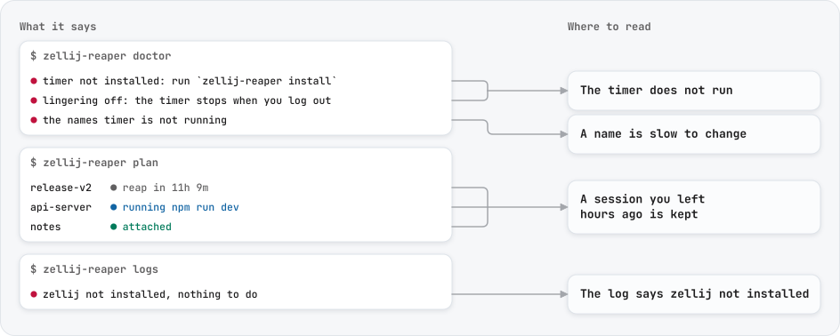

# Troubleshooting zellij-reaper

Start with `zellij-reaper doctor`: one line per thing it needs, and what to do about each one that is off. Then
`zellij-reaper plan`, where every session's row says why it is kept.

<picture>
  <source media="(prefers-color-scheme: dark)" srcset="assets/trouble-dark.svg">
  
</picture>

## The timer does not run

- `systemctl --user status zellij-reaper.timer` says whether systemd knows it. If not, run `zellij-reaper install`.
- Without lingering (`loginctl show-user $USER -p Linger`) the timer stops when you log out. `install` turns it on;
  `doctor` says when it is off.
- On WSL 2, systemd has to be turned on, and the timer stops with the VM: see [setup](setup.md#wsl-2).
- Without systemd, `crontab -l` lists two lines ending in `# zellij-reaper`, which a running cron daemon reads
  ([without systemd](setup.md#without-systemd)).
- On macOS, `launchctl print gui/$(id -u)/io.github.kanggu12.zellij-reaper` shows the launch agent; the first pass
  comes one `interval` (an hour) after install.
- On Windows, the Task Scheduler lists `zellij-reaper` (`Get-ScheduledTask zellij-reaper` in PowerShell). It runs while
  you are logged in.

## Passes run, but nothing happens

`doctor` reads the last pass from the log and says what came of it.

- **It stopped: `zellij list-sessions failed: ... no answer within 10s`.** `zellij list-sessions` asks every session's
  server, and one server that stopped answering makes it wait: every pass then stops and keeps every session.
  `zellij list-sessions` in a shell waits the same way. A server a signal stopped is named on that line, with the
  command that lets it go on (`kill -CONT PID`). One that is stuck some other way is not; `ps -o pid,stat,args -C
  zellij` lists the servers, and `kill PID` ends one that never answers, with its session.
- **It came to only some sessions: `time is up after 40s`.** zellij answered slowly enough that the pass ran out of
  its time; the next pass goes on with the rest.
- **Something holds the pass lock.** A pass waits up to 30 seconds for it, then gives up and leaves the work to the
  holder. `lsof ~/.local/state/zellij-reaper/lock` (on Linux also `fuser -v`) names the process. The system frees the
  lock when that process ends.
- **The log cannot be written**: a full disk (less than 64 KiB left), a read-only file system, or a `log.path`
  somewhere the timer may not write. The passes go on without a record.

## The log says `zellij not installed`, but zellij works in your shell

The service has its own `PATH`. Run `zellij-reaper install` again from a shell where `zellij` resolves (its directory
goes first in the service's `PATH`), or set `zellij = "/path/to/zellij"` in the settings. On Windows the task uses your
user `PATH`: add zellij's folder there, or set `zellij = 'C:\path\zellij.exe'` (single quotes keep the backslashes).

## A renamed session on Windows is kept for good

zellij on Windows cannot reach a session once it is renamed, so zellij-reaper cannot ask it for its clients or delete
it, and keeps it. zellij cannot attach to it either. To close it, end its server: the `zellij.exe` process whose
command line ends in the session's first name, in Task Manager's Details tab.

## A session you left hours ago is kept

Its row in `plan` says why, and the dashboard's panel shows which check stopped it.

- `running ...` (`busy`): something still runs in a pane. Often it is a background job started from the shell, or a
  pane zellij started with a command.
- `attached`: a client is still connected, maybe in another terminal, over SSH or in a browser.
- `reap in ...` (`idle-recent`): a pane's terminal was used more recently than you think, often a program printing to
  it.
- `server not found` (`no-server`) after a rename: the kernel has no `unix_diag` (`doctor` says so), so a renamed
  session cannot be matched to its server, and once one is renamed no running session is. `modprobe unix_diag` where
  that is possible.

## A session's name keeps a `-2`

Two sessions showed the same title, or the session had that name before, which zellij 0.44 and 0.45 refuse to give back
for as long as the session runs; a pass knows the names it saw the session under and asks for the tail at once. The tail
stays, because a name changes only when what the session shows changes, or the project its agent works in; with
`auto_rename_drop_tail = true` it goes once no other session has the name, unless this session had it before. With `r`
you can give it the name without the tail, unless this session had that name before: zellij then keeps the old name, and
the dashboard says so. A name given by hand stays as it is from then on.

## A session is named after the wrong thing

A pass names a session after the focused pane of the tab a client looks at, or of the first tab when nobody is attached,
since zellij then marks no tab active. When that title says nothing, the other running panes come next. Its row in
`plan --json` lists `would_rename`, and `r` in the dashboard shows the name its panes, or its agent's project, point to.
A session where a coding agent runs is named after the git repository its newest commands work in, the one their command
lines name or else the one they run in, once two that passes counted in a row worked there; moving it takes four in a
row in one other repository. Before that, it is named after the repository the agent was started in, or as any other
session when that is none. A path counts only near the work, under your home, where the command runs or beside its
repository, and the program a command runs is no work, so a tool's own checkout, such as Homebrew's on Apple silicon,
names nothing. A command that starts and ends between two passes is not seen, and an agent that goes through many
repositories, one command each, keeps its name. Give it a name with `r` or `zellij action rename-session`, and passes
leave that name alone. To keep the name a running session has now, press `r`, then Tab and Enter. `auto_rename = false`
turns renaming off.

## A session's name never changes

A pass renames only a session whose name zellij made up or a pass gave; a name someone typed, or kept with `r` or
`keep-name`, stays. A session zellij brought back from exited, after a restart say, starts under the name it had, and
until 0.14.1 that read as a name someone typed, so it stayed for good. A pass now tells such a session by the panes
zellij saved for it, in a file zellij keeps, then older than the new server's socket, and renames it again when a pass
gave the name. On a file system that keeps no birth times it cannot tell, and the name stays.

## A `zellij` command hangs in a renamed session

A pane keeps the session name it was opened under, in `ZELLIJ_SESSION_NAME`, so after a rename a `zellij` command run
there without `--session` waits for a session by the old name while any other session is running. Press Ctrl+C, then
`export ZELLIJ_SESSION_NAME=$(zellij-reaper here)`. The prompt hook does that at every prompt:
`command -v zellij-reaper >/dev/null && eval "$(zellij-reaper shell-hook bash)"` in `~/.bashrc`, the same with `zsh` in
`~/.zshrc`, and `type -q zellij-reaper; and zellij-reaper shell-hook fish | source` in fish's `config.fish`.

## A name is slow to change

The names timer renames every `rename_interval` (5 minutes); without it, only the hourly pass does. `doctor` says when
it is not running: run `zellij-reaper install` again, which also picks up a changed `rename_interval`.
`zellij-reaper run --names-only` renames now.

## `plan` and the timer disagree

Settings from variables in your shell (`ZELLIJ_REAPER_PROTECT=...`) apply to the commands you run there, not to the
timer. `doctor` lists each one. Put lasting settings in the settings file.

## A program you leave running on purpose

A program running in a pane makes the pane busy, so its session is kept. A program started with `nohup` or `setsid`
that left the pane no longer counts: the pane looks idle. Protect that session by name.

## A session nothing can delete

A session renamed to a name longer than its socket path allows keeps a server no zellij command can reach, and its
files come back after every delete. `zellij-reaper recover --dry-run` shows what it would repair; without `--dry-run`
it repairs it, and the log keeps each step. A server that serves no socket file at all is counted at the end, with the
command that stops it: `zellij-reaper recover --aggressive`, which leaves one that somebody may still be using.

## Reporting a problem

[CONTRIBUTING.md](../.github/CONTRIBUTING.md#report-a-problem) lists what to put in an issue. A security problem goes
through [SECURITY.md](../.github/SECURITY.md) instead.
